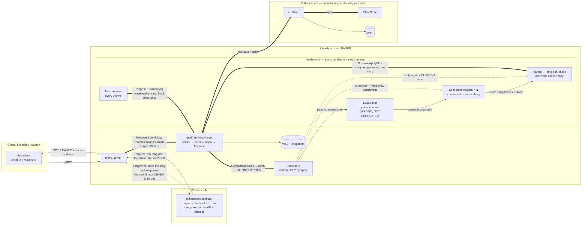

# Fault-tolerant Coordinator

A task coordinator whose control plane is a replicated state machine on [etcd/raft](https://github.com/etcd-io/raft).
Job and task state live in the Raft log, so a coordinator can be `SIGKILL`ed mid-flight and a new leader resumes the queue from the committed prefix — measured at **p50 1441ms / p95 2090ms to first task dispatched by the new leader** over 55 kill trials on the shipped configuration.

Scheduling is modelled on Nomad: state changes create evaluations, scheduler workers compute plans concurrently against a snapshot, and a single-threaded planner verifies each plan against current state before committing it.
That batching takes a fixed 2,000-task backlog from **62.1s to 18.0s** to drain, and the win is the removal of 1,716 serial consensus round trips rather than any reduction in log volume.

Delivery is at-least-once; execution is idempotent on `(taskID, attempt)`, so committed effects are effectively-once.
A 64-seed fault-injection checkpoint recorded **128,830 committed effects over 151,161 executions with zero duplicate commits and zero lost tasks**, under 1,770 coordinator kills and 7,986 partitions.

Every number on this page carries its `n`, its configuration, and its caveat.
The two that matter most: `-snapshot-entries` changes the failover figures by more than any code in this repository, and "max" is always an observed worst case, never a bound.

---

## Scope contract

**What this is.** A 3-node coordinator that owns job and task state, dispatches work to workers that dial in and long-poll, detects worker death by lease expiry, and retries failed attempts under a budget.
It is a control plane: task *output* never enters the Raft log, only a reference and an exit code.

**What is implemented.**

| | |
|---|---|
| Consensus | etcd/raft, 3 nodes, CheckQuorum + PreVote on, one WAL and snapshot store per node |
| Replicated state | jobs, tasks, workers, evaluations — written **only** by the apply path |
| Scheduling | eval broker (derived, not replicated), N concurrent scheduler workers, single-threaded planner with optimistic concurrency, accept / partial / reject |
| Failure detection | worker leases driven by a `Tick` command's timestamp, never by `time.Now()` in apply |
| Delivery | at-least-once dispatch, `(taskID, attempt)` idempotency, effectively-once committed effects |
| Reads | `ReadIndex` barrier on the client read path; unbarriered reads survive only where the state machine re-checks at apply time |
| API | gRPC + Protocol Buffers, `(clientID, requestID)` dedup with a payload hash, `NOT_LEADER` redirects |
| Durability | WAL + snapshots, whole-cluster restart from disk, three independently versioned schemas |
| Observability | Prometheus metrics, pprof, read-only `/debug/workers` and `/debug/tasks` |
| Verification | seeded fault-injection simulator, per-step invariants, convergence checks, Porcupine linearizability checking, an effect ledger |

**What is deliberately out of scope.** Each of these is a decision, not an oversight.

- **No cluster membership changes.** The peer set is fixed at startup.
- **No fencing of external side effects.** A payload that writes to a third-party system writes once per *execution*, so twice if two attempts run. See "Delivery semantics" below.
- **No linearizable reads on the worker RPC path.** Those read state they are about to propose against, and the state machine re-checks the lease at apply time.
- **Snapshots are synchronous and unbounded.** `maybeSnapshot` serializes, fsyncs and compacts inside the Ready loop, and the whole state is one message held in memory twice. This is a measured limitation, below.
- **No multi-tenancy, quotas, preemption or bin-packing.** The planner places tasks on the first worker with a free slot.
- **One workload shape measured well**, rather than five measured badly.

---

## Architecture



**Heavy arrows are the mutation path**, and every one converges on raft; exactly one leaves it into the `StateStore`.
That single-writer property is the load-bearing invariant of the whole design.

**Dashed arrows are reads**, and two of them matter: scheduler workers read a *snapshot*, which is what lets N of them run concurrently touching nothing shared, and the planner reads *current* state to verify a plan built against a possibly-stale one.
That second read is the optimistic-concurrency check.

**Every node owns its own WAL.** "The log" is logical; physically there are three copies, and raft's job is keeping them identical.

**Pull, not push.** Workers dial in and long-poll; the coordinator never dials out. That removes address tracking, reconnection and NAT handling, and gives backpressure for free.

**The subtlest constraint in the system:** the apply path runs on every replica and must be deterministic, so it cannot read the wall clock.
Lease expiry is therefore driven by a timestamp the leader writes into the log itself, as a `Tick` command.

Full design notes, including the command set, the task state machine and every decision's reasoning, are in [docs/architecture.md](docs/architecture.md).

---

## Running it

```sh
make bin   # `make build` only compiles; `make bin` writes ./bin/<binary>

# a 3-node cluster, raft on 7001-7003, gRPC on 8081-8083, metrics on 9091-9093
for i in 1 2 3; do
  ./bin/coordinator -id $i \
    -peers '1=http://127.0.0.1:7001,2=http://127.0.0.1:7002,3=http://127.0.0.1:7003' \
    -api-peers '1=127.0.0.1:8081,2=127.0.0.1:8082,3=127.0.0.1:8083' \
    -addr :808$i -metrics-addr 127.0.0.1:909$i -data-dir ./raft-$i >coord-$i.log 2>&1 &
done

./bin/worker -id w-1 -coordinator 127.0.0.1:8081,127.0.0.1:8082,127.0.0.1:8083 -concurrency 8 &

./bin/schedctl -coordinator 127.0.0.1:8081 submit -n 100 -- /bin/echo hello
# the command is executed by the worker, so give a path that exists on it:
# macOS has /usr/bin/true, not /bin/true
./bin/schedctl -coordinator 127.0.0.1:8081 status <jobID>
./bin/schedctl -coordinator 127.0.0.1:8081 list
```

Any coordinator address will do for a client or a worker: a non-leader answers `NOT_LEADER` with the leader's address and the client follows the redirect.

### The two failure demos

Both are scripted, run against the real cluster, and **check what they claim** rather than narrating it — see [demos/](demos/).

#### Leader dies mid-flight

Submits a backlog, names the leader, `SIGKILL`s it, times the survivor's election and first dispatch, then asserts every submitted task reached a terminal state exactly once.

```
$ ./demos/up.sh 3 4 && TASKS=24 ./demos/failover.sh
== 1. submit 24 tasks ==
job job-7fdaa9ae6623a426
== 2. who leads, and what is in flight ==
leader           node 2
assignments      20 dispatched by node 2
job-7fdaa9ae pending=4 assigned=8 running=3 complete=9
== 3. SIGKILL node 2 ==
killed node 2 (pid 32126) — the cluster is now 2 of 3
== 4. waiting for a survivor to lead and dispatch ==
new leader       node 1 after 1073ms
first dispatch   1109ms after the kill (±10ms, polled)
== 5. the job finishes on the survivors ==
job-7fdaa9ae6623a426  COMPLETE  tasks=24  pending=0 assigned=0 running=0 complete=24 failed=0
24 task(s) terminal, 24 submitted — nothing lost, nothing duplicated
```

*One trial on one host, pasted as it ran.* The distribution is **p50 1441ms / p95 2090ms / max 2584ms over 55 trials** in [results/2026-11-01-day11-reclaim-failover/](results/2026-11-01-day11-reclaim-failover/); a single 1109ms observation is not the number to quote.

#### A worker dies mid-task

Waits until a worker is *RUNNING* a task rather than merely assigned, asserts a free slot exists elsewhere, `SIGKILL`s it, and times lease expiry → reclaim → redispatch as attempt 2 from the last heartbeat received.

```
$ ./demos/up.sh 2 2 && ./demos/reclaim.sh
== 1. submit one long task ==
job job-c250f9a955b61c26
== 2. wait for a worker to be RUNNING it ==
victim w-1 is RUNNING job-c250f9a955b61c26/0000
2 free slot(s) elsewhere
== 3. SIGKILL w-1 ==
killed w-1 (pid 32545)
t=0 = last heartbeat received = 1793757145676ms (lease 1793757147676 - 2000ms TTL), on the committed clock
== 4. lease expiry, reclaim, redispatch ==
reclaimed        2087ms after last heartbeat (±10ms poll)
redispatched     to w-2, 2087ms after last heartbeat
== 5. the attempt number is the idempotency key ==
w-1    cap=2  held=[]
w-2    cap=2  held=[('c26/0000', 'ASSIGNED', 'attempt 2')]
reclaimed in 2087ms, redispatched in 2087ms — consistent with the ~2250ms budget (lease 2000 + tick 200 + commit)
```

*One trial on one host, pasted as it ran.* Reclaim and redispatch report the same figure because they landed in the same 10ms poll — reassignment follows release by roughly 15ms.
The distribution is **p50 2121ms / p95 2217ms / max 2246ms over 100 trials** in [results/2026-11-01-day11-reclaim-failover/](results/2026-11-01-day11-reclaim-failover/).

---

## Benchmarks

**All of these are the real cluster** — three `cmd/coordinator` processes, raft over HTTP, client load over gRPC, no simulator anywhere in the path.
Host: Apple M3 Pro, 11 cores, go1.26.5, darwin/arm64, **fsync always on** (there is no unsafe mode in this build).

**Read the `-snapshot-entries` column first.** It decides whether the raft log compacts, and the log decides how long a restarted node spends applying before it can vote or acknowledge. It moves the failover numbers further than any code change in this repository.

| Measurement | Result | n | Config | Caveat |
|---|---|---|---|---|
| **Time to drain 2,000 tasks**, `-max-plan-size` 1 / 10 / 100 | **62.1s / 18.0s / 19.0s** | 3 runs per arm, median | 8 workers × concurrency 32 = 256 idle slots; 20 jobs × 100 tasks pre-submitted with no workers connected; `-snapshot-entries` **500,000** | A drain of a fixed backlog, not a sustained rate. Plan size saturates near **7**, so `P=100` is marginally *worse* than `P=10`. `P=1` run 3 was slower (93.9s) because its commit latency was slower (p50 48ms vs 29ms), exactly as a serial model predicts |
| Log entries for that backlog | 5,306 → 2,666 per node | same runs | same | **2.0× is the ceiling** on entry reduction: `apply_plan` collapses 2000 → 284, while `complete_task` stays pinned near 2,004 because each completion is its own entry |
| **Worker reclaim**, last heartbeat → task released by the dead worker | **p50 2121 / p95 2217 / max 2246ms** | 100 trials, 100 valid | `-snapshot-entries` 500,000; lease TTL 2000ms, heartbeat 500ms, tick 200ms | **Consistent with the ~2250ms budget**, with the worst case at its edge; ±10ms poll error. Deliberately not reported as a pass count |
| Worker reclaim, kill → task released | p50 1909 / p95 2109 / max 2124ms | 100 trials | same | Shorter than the above by up to one heartbeat, because the worker was alive for part of a lease it had already renewed |
| Worker **redispatch**, last heartbeat → reassigned to another worker | p50 2139 / p95 2248 / max 2280ms | 77 trials | same | A different quantity from reclaim, and the one a user waits on. The other 23 trials had no reassignment *lawfully*: the task hit `MaxAttempts` and went terminal, so there was nothing left to dispatch |
| **Leader failover**, kill → first task dispatched | **p50 1441 / p95 2090 / max 2584ms** | 55 trials, 55 valid | **shipped default, `-snapshot-entries` 10,000**; raft tick 100ms × election tick 10 = 1s election timeout | State grew 1,980 → 19,080 task records across the run and latency drifted **+12%** (1384 → 1554ms). This is the row to quote |
| Leader failover, compaction effectively disabled | p50 1303 / p95 1905 / max 2066ms | 100 trials, 98 valid | `-snapshot-entries` 500,000, cluster rebuilt every 10 trials | Failover **at a median of 990 task records**, not "failover is 1.3s". Of which broker rebuild is p50 0.64ms / max 2.94ms |
| Leader failover, no compaction **and** no resets | 1602ms → **17060ms** (decile medians) | 100 trials | `-snapshot-entries` 500,000, never reset | **Superseded as a latency figure, kept as a product finding.** Monotonic 10×; the cause is restart replay, below |
| Assignments committed/s by state size | 29.4 (10k) / 23.8 (50k) / 3.8 (150k tasks) | 1 run each, 20s window | after the worker-index fix; `-snapshot-entries` 500,000 | A profiling window, not a sustained-throughput benchmark. **No stall boundary up to 150,000 tasks**; beyond ~50,000 the scheduler's per-plan scans dominate |
| Commit latency by state size | 30.8ms (10k) / 35.9ms (50k) / 220.8ms (150k) | same | same | Before the index fix, 10k measured 322–696ms with 7–9 leadership changes per 30s |
| Open-loop submit latency | p50 33.1 / p99 99.3ms | 1 smoke run, 200 jobs/s offered | single-task jobs | Measured **from intended send time**, not from send, so coordinated omission is included. Generator lag p99 0.7ms, so the offered rate was real |
| Synchronous snapshot, worst observed | 133ms at 1,601KB | 64 simulator seeds | stall threshold 125ms | An **fsync tail**, not state size: serialization is ~6.5ms/MB, so 1.6MB accounts for ~10ms. Two worst-case observations, not a growth trend |
| Steady state, no kills | **0 stalls** on all three nodes | 10 minutes, 27,000 task records | shipped default | Establishes that there is no unexplained steady-state apply stall: every real-cluster stall recorded here traces to restart replay or the snapshot fsync tail |

Raw rows, harnesses and per-run READMEs: [results/2026-10-30-day11-batching/](results/2026-10-30-day11-batching/), [results/2026-10-30-day11-profile/](results/2026-10-30-day11-profile/), [results/2026-11-01-day11-reclaim-failover/](results/2026-11-01-day11-reclaim-failover/).

### The two findings the benchmarks produced

**A long poll was scanning all of state under the apply lock.**
`heldTask` sorted every task id in the store to answer a question about one worker, on every pass of every worker's long poll.
The call cost 906.7µs at 10,000 tasks and 5.19ms at 50,000, and at 10,000 it produced Ready-loop stalls reported as 540–695ms (floors, see below), 7–9 leadership changes per 30s window, and commit latency of 322–696ms — at 18% CPU, with 59% of profile samples in mutex wait, which is what said it was not a CPU problem.
A worker→task index maintained inside `Apply` took the same call to **119ns at 1,000 tasks and 72ns at 50,000** — flat instead of growing 70× with the state — and the stalls to zero.
The rule it produced: **no O(state) work under the apply lock on an RPC path.**

**A restarting node applies its backlog inside the Ready loop.**
`newRaft` reported `commit: 23490, applied: 0`, and applying those ~23,500 entries took **6.3 seconds**, during which the node can neither vote nor acknowledge.
The HTTP listener was already serving in 50ms, so the node looked alive while being useless to a quorum.
Four other explanations were eliminated by measurement rather than argument: not task count (a cluster built fresh to 30,000 records failed over in 1132ms), not restart cycles (45 consecutive kills with a bounded backlog stayed flat at 986–2062ms), not broker rebuild (1.3 → 29.4ms, which is 0.18% of the growth), not WAL read (50ms against 31ms on an empty log).
Compaction **bounds** this and does not remove it: under the shipped 10,000 the same workload cost 12% instead of 10×, and replay fell to 2357ms for ~2,900 entries — but a node a full 10,000 entries behind would still exceed the 1s election timeout.

---

## Verification

Three tiers, each checking something the cheaper ones structurally cannot.
The table of which property is checked by which tier is in [docs/architecture.md](docs/architecture.md#which-safety-properties-are-checked-and-when); the point of keeping it is to prevent believing Porcupine covered something only a per-step invariant looked at.

### The Day 10 checkpoint — 64 seeds × 600 steps

Commit `e633366`, against the additive-isolation adversary, 2h47m38s of cumulative run time.
Full record and per-seed rows: [results/2026-10-30-checkpoint-additive/](results/2026-10-30-checkpoint-additive/).

```
FAULTS INDUCED: 1770 kills, 1770 restarts, 7986 partitions, 3063 leader partitions, 3587 heals
EFFECTS: 128830 committed over 151161 executions (5071 duplicate reports ignored, 7793 terminal by attempt budget)
LEDGER COVERAGE: 308 overlapping executions (floor 200), 558 late reports rejected as stale (floor 300)
DRAIN: 63 of 64 reached quiescence, 63 of those drained; 63 completed all 600 steps
STALLS: 0 host-io, 0 unattributable
SNAPSHOT BUDGET: 1 stall (known product limitation)
LINEARIZABILITY: 64 histories, 0 Illegal, 296,674 ops checked, 12% ambiguous
```

Zero `invariant`, `convergence`, `ready-loop-stall`, `effect-ledger`, `did-not-drain` or `comparison-floor` finding in any of the 64 rows.
**The coverage numbers are the load-bearing part.** 308 overlapping executions means idempotency was actually exercised 308 times; 558 stale rejections means a late report from a dead attempt actually reached a coordinator and was actually discarded that many times.
Both are floors calibrated from an earlier sweep, and a run that cleared neither would be reported INCONCLUSIVE rather than as a pass.

The one truncated seed is a **synchronous-snapshot stall on a host whose own probes stayed inside budget**, so it is classified as a known product limitation rather than as a host failure, and that seed contributes no claim.

### Linearizability — the targeted sweeps, not the checkpoint

The checkpoint's 64 histories are **0 of 64 covered**, and that is not a defect: under the shipped configuration CheckQuorum steps a cut-off leader down in about one election timeout, so the split-brain read window does not open by chance.
Zero Illegal there is therefore *not* linearizability evidence, and the report says so in those words.

The evidence is the targeted sweeps — `make sweeps`, n = 8, seeds 1–8, 7 steps:

| adversary | read mode | Illegal | covered |
|---|---|---|---|
| pinned (`DisableCheckQuorum`) | `local` | **8/8** | 8/8 |
| pinned | `readindex` | **0/8** | 8/8 |
| shipped + GC-pause fault | `local` | **8/8** | 8/8 |
| shipped + GC-pause fault | `readindex` | **0/8** | 8/8 |
| shipped, no pause | `local` | 0/8 | 0/8 |

Two clean A/Bs: same adversary, same coverage, opposite verdicts, the read mode the only variable.
The last row is the informative zero, and **it is only zero at that width** — at 12 steps and 12 seeds it measures 1/12 Illegal with 3/12 covered, a stale read reachable on the shipped configuration with no pause at all.

### What the harness found

Three product bugs, none of which any test that existed could see.

**An unreported `MsgSnap` parked a follower forever.**
etcd/raft puts a follower in `StateSnapshot` and pauses every log probe to it until the application calls `Node.ReportSnapshot` — which nothing in this build ever called, in either transport.
The transport swallowed its send error under the comment *"peer down or partitioned; raft's own protocol retries"*, which is true of `MsgApp` and false of `MsgSnap`.
It is silent in the worst way: the parked follower keeps answering heartbeats, so `RecentActive` stays true, CheckQuorum is satisfied, the leader is never deposed, and it simply holds its term and commits nothing.
Reproduced deterministically from one dropped `MsgSnap` (`commit=486`, `paused=TRUE`, six seconds of lost proposals → `commit=489`, `StateReplicate`), fixed in `raftnode` so both transports share it, and the frozen-clock windows it matches went from **4 of 64 seeds to 0 of 64** under the unchanged adversary.
What is claimed is bounded: the mechanism is proven and the fix verified, but the original windows were captured before the raft progress table was instrumented, so none of them *shows* a parked follower and the attribution of those five windows stays formally unproven.

**A deadlock on leadership revocation.**
`onLeadershipChanged` ran on the Ready loop goroutine and waited for scheduler workers, while a scheduler worker could be parked waiting for a proposal only the Ready loop could deliver.
It self-healed after the 5s proposal timeout, which is what hid it: the symptom was not a hang but a node processing no raft messages for five seconds on every leadership change — long enough to trigger the next election and do it again.

**A publish-before-run race.**
`StartRaft` launched the Ready loop and then assigned `c.raft`, which the loop immediately read. The cluster tests start each node once, so the window never opened; the simulator restarts nodes constantly and hit it within ten steps.

### Reproducibility and the test suite

- `TestSameSeedReproducesTheFaultSchedule` — **25 of 25** consecutive runs.
- `TestReplayWindowReproducesTheRealizedWindow` — **10 of 10**. A targeted window reproduces the adversary's *intent*, not its realization, so the realization is recorded and fed back explicitly.
- `make test race` — 20 packages, the 8 with tests all green; `internal/sim` alone is ~5 minutes.
- `make release-check` is `vet test race repro sweeps` plus a host fsync gate: everything a tag would assert.
- The invariant checker is itself tested against planted corruption. A detector that has never caught anything is indistinguishable from one that cannot.

---

## Delivery semantics: what "effectively-once" covers, and what it does not

Delivery is **at-least-once**.
A task may be executed more than once, and under fault injection it regularly is: a worker that goes slow or is descheduled loses its lease, the coordinator reclaims the task and dispatches the next attempt, and the first attempt keeps running.
Two workers executing one task at the same time is this system working as designed, not a defect.

Effects are **effectively-once, for effects routed through the result tree**.
Each attempt writes to its own directory, `<workerDir>/<taskID>/<attempt>/`, and reports `(taskID, attempt)` back.
The state machine accepts a report only when the attempt it names is still the live one, so exactly one attempt's result is ever committed, and a late report naming a dead attempt is a silent no-op on every replica.
That is what makes the *committed* effect unique even though the *executions* are not.

**External side effects run at-least-once.**
If a task's payload posts to a third-party API, sends an email, or writes to a database the coordinator knows nothing about, that happens once per execution — so twice if two attempts execute.
Nothing here can prevent it: the payload's writes are outside the result tree, and the coordinator learns about an attempt only when it reports.
Preventing it would require **fencing** — the payload presenting a monotonic token that the downstream system checks and rejects when stale — which this system does not implement and does not claim.
A payload that needs single-execution semantics must be idempotent on `FTC_TASK_ID`, which the executor passes in its environment alongside `FTC_ATTEMPT`.

The simulator measures both halves of this and reports them, because a run that never overlapped did not test the claim at all: see `Ledger.Overlaps` (executions that ran simultaneously) and `Ledger.StaleRejected` (late reports that reached a coordinator and were discarded).
A zero in either is reported as INCONCLUSIVE rather than as a pass.

### Idempotency keys: the caller's half of the contract

`SubmitJob` takes a `(client_id, request_id)` pair, and the coordinator remembers the response it produced for one.
That is what makes the call safe to retry through a failover.
Two rules make it work, and both are the caller's responsibility.

**The key must be globally unique across clients AND restarts.**
Not per-process.
A counter that restarts with the process produces the same key for different work, and the coordinator will faithfully return the first submission's answer.
Use a UUID, or derive the key from the work itself.

**The key must be derived from the logical work item, never from who sends it.**
A key that folds in a worker index, a goroutine id or a connection makes dedup depend on scheduling: the same retry can land under a different key and create a second job, which is the duplicate the mechanism exists to prevent.

**Reuse with a different payload is rejected.**
Since the payload-hashed-session command version, submitting different work under a key that was already used returns **`InvalidArgument`** (`request id reused for different work`).
The payload is the task specs and the priority; job ids, task ids and timestamps are assigned by the leader per proposal and are deliberately NOT part of it, which is why a genuine retry — one that arrives with a fresh job id — still replays correctly.

**A retry must resend the identical request.**
Changing the task list, the command, the args, the timeout, the attempt cap or the priority makes it a different submission, and under the same key that is an error rather than a retry.

**This is a behaviour change.**
Earlier builds silently returned the original job for any reuse, so a caller that retried with a slightly different request got a success and work that was never created.
The rejection is definitive — nothing was created, and retrying cannot help — so clients should treat it as a bug in their key generation rather than something to back off and repeat.

---

## What this does not prove

The verification is the most valuable part of this project, which is exactly why its limits are stated rather than left to be discovered.

**Seeded fault injection is not deterministic simulation testing.**
Faults are injected **between steps, not mid-apply**: the simulator kills, restarts, partitions, drops, delays, corrupts and pauses, but it cannot stop a node halfway through applying an entry, because the state machine has no such hook.
Time is compressed rather than virtualized, so the runs are sensitive to the host — which is why every checkpoint brackets itself with fsync and CPU probes and refuses to quote rates from a run whose host broke the premise.
The simulator also **does not run the worker binary**: it calls the gRPC service directly, so the real worker's heartbeat loop, long-poll backoff, subprocess executor and local claim dedup are covered by unit tests only, not under induced faults.
And it never kills below quorum: with 3 nodes at most one is down at a time, because a cluster that cannot commit stops testing anything. Minority partitions cover the no-progress case instead.

**Porcupine cannot prove linearizability.**
It builds confidence that an *observed history* is not obviously violating it, and that confidence is bounded by what the history covered — which is why a coverage count sits next to every verdict, and why the checkpoint's 64 clean histories are reported as 0-of-64 covered rather than as 64 passes.
12% of operations in those histories were ambiguous (timed out or returned without a definitive answer) and are recorded as PENDING rather than dropped; dropping them is how a failing history quietly becomes a passing one.

**`CheckQuorum` narrows the stale-read window; `ReadIndex` closes it.**
A leader that stops hearing from a majority steps down after an election timeout — measured at 230ms against a 250ms timeout — so the window shrinks from *forever* to *one election timeout*, and reads served inside it are still stale.
That is not a timing argument: at 12 steps the shipped configuration produced **1/12 Illegal with 3/12 covered** with no pause fault at all.
The `ReadIndex` barrier is what makes a cut-off leader **fail instead of lying** (`Unavailable`, never `NotFound`), and it is on the client read path only.

**Stall durations recorded before commit `17b792a` are FLOORS, not blocked time.**
The watchdog polled at `threshold/2` and reported once per stall, so the duration it reported was elapsed-time-at-detection, quantized into `[threshold, 1.5× threshold]` whatever the real blockage was — a six-second stall was reported as roughly 500ms.
Later builds also report a completed duration.
Any stall figure in `results/` directories older than that commit should be read as "at least this long".

**"Max" is an observed worst case, not a bound.**
Every percentile here comes from a finite trial count on one host, polled at 10ms resolution.
Worker reclaim's 2246ms worst case sits at the edge of its own ~2250ms budget, which is why it is reported as "consistent with" rather than as 100/100 passing.

**One red remains attributed rather than explained.**
A `ready-loop-stall` violation appeared on one simulator seed 2 times in 9 runs on a host six hours into benchmarking, and then 0 times in 40 interleaved runs on a rested one — a 0.65% outcome at the observed rate, which is why it is attributed to host degradation **by rate comparison, with no mechanism claimed**.
CPU contention is specifically *not* implicated: scheduler overshoot overlapped between the two hosts (242µs failing, 139–274µs passing). The clear differences were fsync mean 5.9ms versus ≤3.85ms, and hours of sustained prior load.

**Known gaps are listed, not hidden.** [docs/architecture.md § Known gaps carried forward](docs/architecture.md#known-gaps-carried-forward) carries the full list, including the unbounded snapshot, the `ApplyPlan` stop that does not respect the attempt budget, and the eval broker's over-broad unblock.

---

## Repository map

| Path | What is in it |
|---|---|
| `cmd/coordinator` | the server: raft node, gRPC, scheduler, metrics, debug endpoints |
| `cmd/worker` | the worker: register, long-poll, execute as a subprocess, heartbeat, report |
| `cmd/schedctl` | the CLI |
| `cmd/loadgen` | open-loop load generator — intended send time, hdrhistogram, submission verification |
| `cmd/simulator`, `internal/sim`, `internal/simnet` | the fault-injection simulator, its adversaries and its oracles |
| `cmd/fsyncprobe` | the host probe every measurement brackets itself with |
| `internal/state` | the state machine — the only writer is `Apply` |
| `internal/sched` | eval broker, scheduler workers, planner |
| `internal/raftnode` | the Ready loop, WAL, snapshots, stall detection |
| `internal/server` | gRPC service, raft wiring, coordinator lifecycle |
| `proto/` | three independently versioned schemas: API, log commands, snapshots |
| `demos/` | the two failure demos and their cluster harness |
| `docs/writeup.md` | the four problems that were actually hard, read once, start to finish |
| `docs/architecture.md` | the design, decision by decision, with what each one cost |
| `docs/roadmap.md` | how it was built, day by day, including what each day got wrong |
| `results/` | every quoted number, with its rows, its harness and its run-stamped README |
