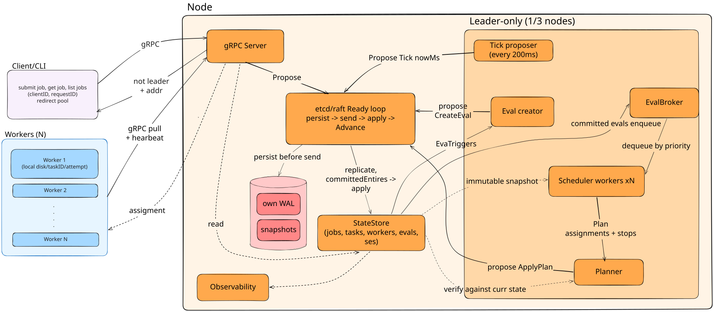
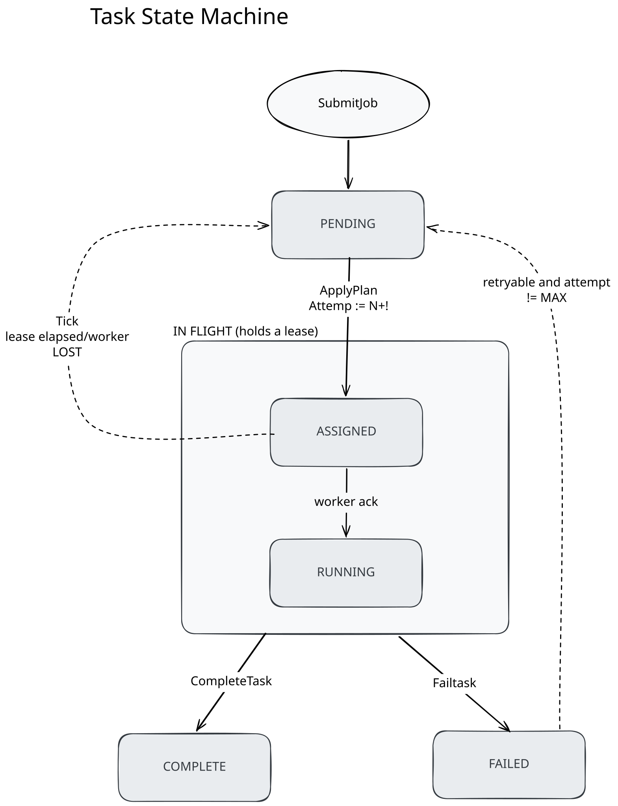

# Distributed Fault-tolerant Coordinator

A task coordinator whose control plane is a replicated state machine on [etcd/raft](https://github.com/etcd-io/raft).
Job and task state live in the Raft log, so a coordinator can be `SIGKILL`ed mid-flight and a new leader resumes the queue from the committed prefix — measured at **p50 1441ms / p95 2090ms to first task dispatched by the new leader** over 55 kill trials on the shipped configuration.

Scheduling is modelled on Nomad: state changes create evaluations, scheduler workers compute plans concurrently against a snapshot, and a single-threaded planner verifies each plan against current state before committing it.
That batching takes a fixed 2,000-task backlog from **62.1s to 18.0s** to drain, and the win is the removal of 1,716 serial consensus round trips rather than any reduction in log volume.

Delivery is at-least-once; execution is idempotent on `(taskID, attempt)`, so committed effects are effectively-once.
A 64-seed fault-injection checkpoint recorded **128,830 committed effects over 151,161 executions with zero duplicate commits and zero lost tasks**, under 1,770 coordinator kills and 7,986 partitions.

Every number on this page carries its `n`, its configuration, and its caveat.
The two that matter most: `-snapshot-entries` changes the failover figures by more than any code in this repository, and "max" is always an observed worst case, never a bound.

---

## Scope contract

**What this is.** A 3-node coordinator that owns job and task state, dispatches work to workers that dial in and long-poll, detects worker death by lease expiry, and retries failed attempts under a budget.
It is a control plane: task *output* never enters the Raft log, only a reference and an exit code.

**What is implemented.**

| | |
|---|---|
| Consensus | etcd/raft, 3 nodes, CheckQuorum + PreVote on, one WAL and snapshot store per node |
| Replicated state | jobs, tasks, workers, evaluations — written **only** by the apply path |
| Scheduling | eval broker (derived, not replicated), N concurrent scheduler workers, single-threaded planner with optimistic concurrency, accept / partial / reject |
| Failure detection | worker leases driven by a `Tick` command's timestamp, never by `time.Now()` in apply |
| Delivery | at-least-once dispatch, `(taskID, attempt)` idempotency, effectively-once committed effects |
| Reads | `ReadIndex` barrier on the client read path; unbarriered reads survive only where the state machine re-checks at apply time |
| API | gRPC + Protocol Buffers, `(clientID, requestID)` dedup with a payload hash, `NOT_LEADER` redirects |
| Durability | WAL + snapshots, whole-cluster restart from disk, three independently versioned schemas |
| Observability | Prometheus metrics, pprof, read-only `/debug/workers` and `/debug/tasks` |
| Verification | seeded fault-injection simulator, per-step invariants, convergence checks, Porcupine linearizability checking, an effect ledger |

**What is deliberately out of scope.** Each of these is a decision, not an oversight.

- **No cluster membership changes.** The peer set is fixed at startup.
- **No fencing of external side effects.** A payload that writes to a third-party system writes once per *execution*, so twice if two attempts run. See "Delivery semantics" below.
- **No linearizable reads on the worker RPC path.** Those read state they are about to propose against, and the state machine re-checks the lease at apply time.
- **Snapshots are synchronous and unbounded.** `maybeSnapshot` serializes, fsyncs and compacts inside the Ready loop, and the whole state is one message held in memory twice. This is a measured limitation, below.
- **No multi-tenancy, quotas, preemption or bin-packing.** The planner places tasks on the first worker with a free slot.
- **One workload shape measured well**, rather than five measured badly.

---

## Architecture


**Thick arrows are the mutation path**, and every one converges on raft; exactly one leaves it into the `StateStore`.
That single-writer property is the load-bearing invariant of the whole design.

**Dashed arrows are reads**, and two of them matter: scheduler workers read a *snapshot*, which is what lets N of them run concurrently touching nothing shared, and the planner reads *current* state to verify a plan built against a possibly-stale one.
That second read is the optimistic-concurrency check.

**Every node owns its own WAL.** "The log" is logical; physically there are three copies, and raft's job is keeping them identical.

**Pull, not push.** Workers dial in and long-poll; the coordinator never dials out. That removes address tracking, reconnection and NAT handling, and gives backpressure for free.

**The subtlest constraint in the system:** the apply path runs on every replica and must be deterministic, so it cannot read the wall clock.
Lease expiry is therefore driven by a timestamp the leader writes into the log itself, as a `Tick` command.

### The task state machine


- **`Attempt` is a dispatch counter, and only `ApplyPlan` increments it.** That is what makes a slow worker's late report detectably stale rather than a duplicate.
- **`COMPLETE` and `FAILED` are terminal.** A retryable failure goes straight back to `PENDING` and never passes through `FAILED`; every later report for a terminal task is a no-op on every replica.
- **Failure backs off; lease expiry does not.** A failed task may be crash-looping, so it waits out an exponential, deterministically jittered `NotBeforeMs` (capped at 30s), and `Tick` emits a `BACKOFF_ELAPSED` eval when it passes. A reclaimed task never got its chance, and the reclaim budget has no room for a delay.
- **Every path back to `PENDING` respects the attempt budget**, or a capped task would be pending and undispatchable forever.
- **Job state is derived, never set:** `RUNNING` on the first assignment, then `COMPLETE`, or `FAILED` if any task failed, once every task is terminal.

### The command set

Every state mutation is one of seven commands, and the `oneof` in `proto/command.proto` makes the set closed:

```
SubmitJob{clientID, requestID, jobID, tasks[], priority, createdMs}
CreateEval{evalID, jobID, priority, triggeredBy, createdMs}
ApplyPlan{evalID, assignments[], stops[]}
CompleteTask{taskID, attempt, workerID, resultRef, exitCode, completedMs}
FailTask{taskID, attempt, workerID, err, retryable, exitCode, failedMs}
RegisterWorker{workerID, registeredMs, leaseExpiryMs, runningTaskIDs[], capacity}
Tick{nowMs}
```

---

## Running it

```sh
make bin

# a 3-node cluster, raft on 7001-7003, gRPC on 8081-8083, metrics on 9091-9093
for i in 1 2 3; do
  ./bin/coordinator -id $i \
    -peers '1=http://127.0.0.1:7001,2=http://127.0.0.1:7002,3=http://127.0.0.1:7003' \
    -api-peers '1=127.0.0.1:8081,2=127.0.0.1:8082,3=127.0.0.1:8083' \
    -addr :808$i -metrics-addr 127.0.0.1:909$i -data-dir ./raft-$i >coord-$i.log 2>&1 &
done

./bin/worker -id w-1 -coordinator 127.0.0.1:8081,127.0.0.1:8082,127.0.0.1:8083 -concurrency 8 &

./bin/schedctl -coordinator 127.0.0.1:8081 submit -n 100 -- /bin/echo hello
# the command is executed by the worker, so give a path that exists on it:
# macOS has /usr/bin/true, not /bin/true
./bin/schedctl -coordinator 127.0.0.1:8081 status <jobID>
./bin/schedctl -coordinator 127.0.0.1:8081 list
```

Any coordinator address will do for a client or a worker: a non-leader answers `NOT_LEADER` with the leader's address and the client follows the redirect.

### The two failure demos

Both are scripted, run against the real cluster, and **check what they claim** rather than narrating it — see [demos/](demos/).

#### Leader dies mid-flight

Submits a backlog, names the leader, `SIGKILL`s it, times the survivor's election and first dispatch, then asserts every submitted task reached a terminal state exactly once.

```
$ ./demos/up.sh 3 4 && TASKS=24 ./demos/failover.sh
== 1. submit 24 tasks ==
job job-7fdaa9ae6623a426
== 2. who leads, and what is in flight ==
leader           node 2
assignments      20 dispatched by node 2
job-7fdaa9ae pending=4 assigned=8 running=3 complete=9
== 3. SIGKILL node 2 ==
killed node 2 (pid 32126) — the cluster is now 2 of 3
== 4. waiting for a survivor to lead and dispatch ==
new leader       node 1 after 1073ms
first dispatch   1109ms after the kill (±10ms, polled)
== 5. the job finishes on the survivors ==
job-7fdaa9ae6623a426  COMPLETE  tasks=24  pending=0 assigned=0 running=0 complete=24 failed=0
24 task(s) terminal, 24 submitted — nothing lost, nothing duplicated
```

*One trial on one host, pasted as it ran.* The distribution is **p50 1441ms / p95 2090ms / max 2584ms over 55 trials** in [results/reclaim-failover/](results/reclaim-failover/); a single 1109ms observation is not the number to quote.

#### A worker dies mid-task

Waits until a worker is *RUNNING* a task rather than merely assigned, asserts a free slot exists elsewhere, `SIGKILL`s it, and times lease expiry → reclaim → redispatch as attempt 2 from the last heartbeat received.

```
$ ./demos/up.sh 2 2 && ./demos/reclaim.sh
== 1. submit one long task ==
job job-c250f9a955b61c26
== 2. wait for a worker to be RUNNING it ==
victim w-1 is RUNNING job-c250f9a955b61c26/0000
2 free slot(s) elsewhere
== 3. SIGKILL w-1 ==
killed w-1 (pid 32545)
t=0 = last heartbeat received = 1793757145676ms (lease 1793757147676 - 2000ms TTL), on the committed clock
== 4. lease expiry, reclaim, redispatch ==
reclaimed        2087ms after last heartbeat (±10ms poll)
redispatched     to w-2, 2087ms after last heartbeat
== 5. the attempt number is the idempotency key ==
w-1    cap=2  held=[]
w-2    cap=2  held=[('c26/0000', 'ASSIGNED', 'attempt 2')]
reclaimed in 2087ms, redispatched in 2087ms — consistent with the ~2250ms budget (lease 2000 + tick 200 + commit)
```

*One trial on one host, pasted as it ran.* Reclaim and redispatch report the same figure because they landed in the same 10ms poll — reassignment follows release by roughly 15ms.
The distribution is **p50 2121ms / p95 2217ms / max 2246ms over 100 trials** in [results/reclaim-failover/](results/reclaim-failover/).

---

## Benchmarks

**All of these are the real cluster** — three `cmd/coordinator` processes, raft over HTTP, client load over gRPC, no simulator anywhere in the path.
Host: Apple M3 Pro, 11 cores, go1.26.5, darwin/arm64, **fsync always on** (there is no unsafe mode in this build).

**Read the `-snapshot-entries` column first.** It decides whether the raft log compacts, and the log decides how long a restarted node spends applying before it can vote or acknowledge. It moves the failover numbers further than any code change in this repository.

| Measurement | Result | n | Config | Caveat |
|---|---|---|---|---|
| **Time to drain 2,000 tasks**, `-max-plan-size` 1 / 10 / 100 | **62.1s / 18.0s / 19.0s** | 3 runs per arm, median | 8 workers × concurrency 32 = 256 idle slots; 20 jobs × 100 tasks pre-submitted with no workers connected; `-snapshot-entries` **500,000** | A drain of a fixed backlog, not a sustained rate. Plan size saturates near **7**, so `P=100` is marginally *worse* than `P=10`. `P=1` run 3 was slower (93.9s) because its commit latency was slower (p50 48ms vs 29ms), exactly as a serial model predicts |
| Log entries for that backlog | 5,306 → 2,666 per node | same runs | same | **2.0× is the ceiling** on entry reduction: `apply_plan` collapses 2000 → 284, while `complete_task` stays pinned near 2,004 because each completion is its own entry |
| **Worker reclaim**, last heartbeat → task released by the dead worker | **p50 2121 / p95 2217 / max 2246ms** | 100 trials, 100 valid | `-snapshot-entries` 500,000; lease TTL 2000ms, heartbeat 500ms, tick 200ms | **Consistent with the ~2250ms budget**, with the worst case at its edge; ±10ms poll error. Deliberately not reported as a pass count |
| Worker reclaim, kill → task released | p50 1909 / p95 2109 / max 2124ms | 100 trials | same | Shorter than the above by up to one heartbeat, because the worker was alive for part of a lease it had already renewed |
| Worker **redispatch**, last heartbeat → reassigned to another worker | p50 2139 / p95 2248 / max 2280ms | 77 trials | same | A different quantity from reclaim, and the one a user waits on. The other 23 trials had no reassignment *lawfully*: the task hit `MaxAttempts` and went terminal, so there was nothing left to dispatch |
| **Leader failover**, kill → first task dispatched | **p50 1441 / p95 2090 / max 2584ms** | 55 trials, 55 valid | **shipped default, `-snapshot-entries` 10,000**; raft tick 100ms × election tick 10 = 1s election timeout | State grew 1,980 → 19,080 task records across the run and latency drifted **+12%** (1384 → 1554ms). This is the row to quote |
| Leader failover, compaction effectively disabled | p50 1303 / p95 1905 / max 2066ms | 100 trials, 98 valid | `-snapshot-entries` 500,000, cluster rebuilt every 10 trials | Failover **at a median of 990 task records**, not "failover is 1.3s". Of which broker rebuild is p50 0.64ms / max 2.94ms |
| Leader failover, no compaction **and** no resets | 1602ms → **17060ms** (decile medians) | 100 trials | `-snapshot-entries` 500,000, never reset | **Superseded as a latency figure, kept as a product finding.** Monotonic 10×; the cause is restart replay, below |
| Assignments committed/s by state size | 29.4 (10k) / 23.8 (50k) / 3.8 (150k tasks) | 1 run each, 20s window | after the worker-index fix; `-snapshot-entries` 500,000 | A profiling window, not a sustained-throughput benchmark. **No stall boundary up to 150,000 tasks**; beyond ~50,000 the scheduler's per-plan scans dominate |
| Commit latency by state size | 30.8ms (10k) / 35.9ms (50k) / 220.8ms (150k) | same | same | Before the index fix, 10k measured 322–696ms with 7–9 leadership changes per 30s |
| Open-loop submit latency | p50 33.1 / p99 99.3ms | 1 smoke run, 200 jobs/s offered | single-task jobs | Measured **from intended send time**, not from send, so coordinated omission is included. Generator lag p99 0.7ms, so the offered rate was real |
| Synchronous snapshot, worst observed | 133ms at 1,601KB | 64 simulator seeds | stall threshold 125ms | An **fsync tail**, not state size: serialization is ~6.5ms/MB, so 1.6MB accounts for ~10ms. Two worst-case observations, not a growth trend |
| Steady state, no kills | **0 stalls** on all three nodes | 10 minutes, 27,000 task records | shipped default | Establishes that there is no unexplained steady-state apply stall: every real-cluster stall recorded here traces to restart replay or the snapshot fsync tail |

Raw rows, harnesses and per-run READMEs: [results/plan-batching/](results/plan-batching/), [results/scale-profile/](results/scale-profile/), [results/reclaim-failover/](results/reclaim-failover/).

---

## Repository

| Path | Content |
|---|---|
| `cmd/coordinator` | the server: raft node, gRPC, scheduler, metrics, debug endpoints |
| `cmd/worker` | the worker: register, long-poll, execute as a subprocess, heartbeat, report |
| `cmd/schedctl` | the CLI |
| `cmd/loadgen` | open-loop load generator — intended send time, hdrhistogram, submission verification |
| `cmd/simulator`, `internal/sim`, `internal/simnet` | the fault-injection simulator, its adversaries and its oracles |
| `cmd/fsyncprobe` | the host probe every measurement brackets itself with |
| `internal/state` | the state machine — the only writer is `Apply` |
| `internal/sched` | eval broker, scheduler workers, planner |
| `internal/raftnode` | the Ready loop, WAL, snapshots, stall detection |
| `internal/server` | gRPC service, raft wiring, coordinator lifecycle |
| `proto/` | three independently versioned schemas: API, log commands, snapshots |
| `demos/` | the two failure demos and their cluster harness |
| `results/` | every quoted number, with its rows, its harness and its run-stamped README |
