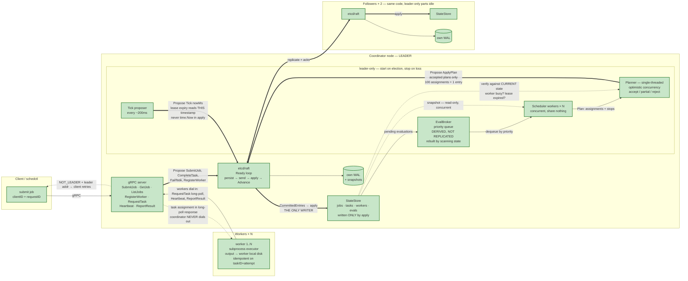
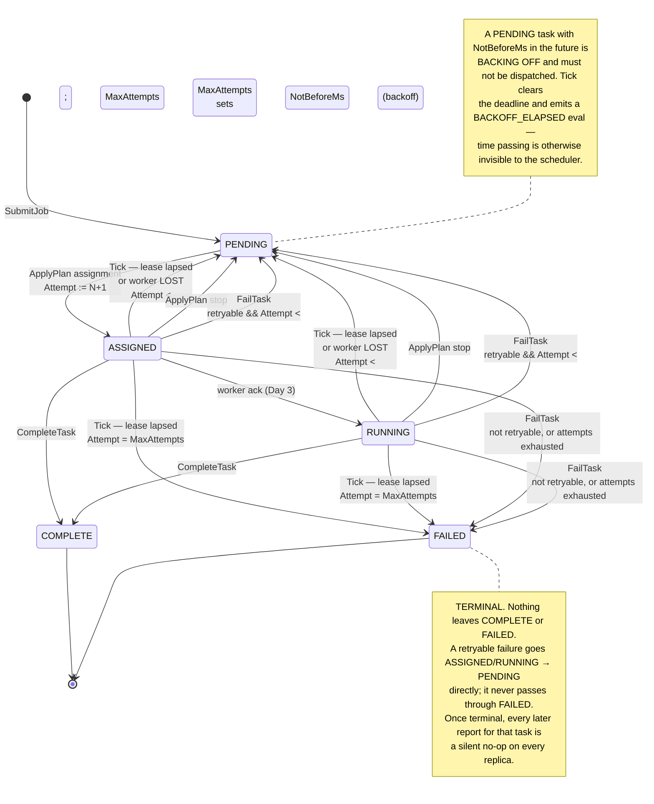

# Architecture

Target architecture for the fault-tolerant coordinator.
Green nodes are implemented; orange nodes are not yet built.
Update the `classDef` assignments at the bottom of the diagram as days complete.

**Status: end of Day 8.** Day 9 (Porcupine) is next; see the roadmap's "Day 8 — completed" section for the handover summary.



## Reading the diagram

**Heavy arrows (`==>`) are the mutation path.** Every one of them converges on `etcd/raft`, and exactly one leaves it into the `StateStore`.
That single-writer property is the design's load-bearing invariant: because Days 2–5 route every mutation through one closed command path, wiring in Raft on Day 6 is a swap rather than a rewrite.

**Dashed arrows are reads**, and two of them matter:

- Scheduler workers read a *snapshot*, which is what lets N of them run concurrently while touching nothing shared.
- The planner reads *current* state to verify a plan built against a possibly-stale snapshot. That's the optimistic-concurrency check.

**Every node owns its own WAL.** "The log" is logical; physically there are three copies, and Raft's job is keeping them identical.

**Pull, not push.** Workers dial in and long-poll; the coordinator never dials out. This removes address tracking, reconnection, and NAT handling, and provides backpressure for free.

**Task output never enters the Raft log** — only a reference plus exit code. Keeping the replicated log small is a deliberate production pattern.

## Two schemas, not one

`proto/scheduler.proto` and `proto/command.proto` are deliberately separate, because they evolve under different pressure:

| | `scheduler.proto` — the API | `command.proto` — the log |
|---|---|---|
| Consumers | clients and workers | every replica, forever |
| Breaking it costs | client upgrades | replay of data already on disk |
| Nondeterminism | allowed (a request may omit IDs) | forbidden — every field is a *decided fact* |

**An RPC is a request; a command is a decided fact.**
A client's `SubmitJobRequest` carries no `job_id` — the leader assigns one, then proposes a `SubmitJob` command carrying it.
Anything nondeterministic (IDs, timestamps, random choices) must be decided once by the leader and baked into the command, because `Apply` runs on every replica and must reach the same answer.

Field numbers are the versioning mechanism: adding a new number is always safe (old decoders skip unknown fields), renumbering or reusing one is never safe.
`FailTask.exit_code = 7` was added after fields 1–6 already existed, as a live example.

## The command set

Every state mutation is one of these, and nothing else.
The `oneof` in `command.proto` makes this a closed sum type, so the compiler — not discipline — enforces that there is no eighth way to change state:

```
SubmitJob{clientID, requestID, jobID, tasks[], priority, createdMs}
CreateEval{evalID, jobID, priority, triggeredBy, createdMs}
ApplyPlan{evalID, assignments[], stops[]}
CompleteTask{taskID, attempt, workerID, resultRef, exitCode, completedMs}
FailTask{taskID, attempt, workerID, err, retryable, exitCode, failedMs}
RegisterWorker{workerID, registeredMs, leaseExpiryMs, runningTaskIDs[], capacity}
Tick{nowMs}
```

### RPCs map onto commands lossily, in both directions

| RPC (what the outside world calls) | Command (what enters the log) |
|---|---|
| `SubmitJob` | `SubmitJob` — with IDs the leader assigned |
| `GetJob`, `ListJobs` | *none* — reads never enter the log |
| `RegisterWorker` | `RegisterWorker` — carries `capacity`, which the planner needs to know when a worker is full |
| `Heartbeat` | `RegisterWorker` — **renewal is re-registration**, carrying `running_task_ids` and `capacity: 0` meaning "unchanged" |
| `RequestTask` | *none* — delivers a decision `ApplyPlan` already committed |
| `ReportResult` | `CompleteTask` **or** `FailTask`, by exit code |
| *none* | `ApplyPlan` — proposed by the planner |
| *none* | `CreateEval` — proposed by the leader |
| *none* | `Tick` — proposed every ~200ms by the Tick proposer |

Two consequences worth stating out loud:

- **There is no `Heartbeat` command.** Keeping the set closed means lease renewal reuses `RegisterWorker` with a fresh `lease_expiry_ms`, so registration and renewal are one idempotent path. Renewal also extends the leases of that worker's live tasks — otherwise `Tick` would reclaim work from a perfectly healthy worker.
- **`RequestTask` looks like it mutates and does not.** The assignment was already decided and committed by an `ApplyPlan`; the RPC just hands the worker something already true. Delivering a decision is a read.

## The task state machine

`Attempt` is a **dispatch counter**, and `ApplyPlan` is the only thing that increments it.
Lease expiry, plan stops, and `FailTask` all leave it alone.
Leaving it alone is what makes a slow worker's late report — carrying an older attempt — detectably stale rather than a duplicate, and it is what turns at-least-once *delivery* into effectively-once *effects*.

But every path that returns a task to `PENDING` must respect the same budget.
`ApplyPlan` rejects any assignment asking for `attempt > MaxAttempts`, so a task reclaimed at the cap would be `PENDING` and undispatchable forever — a scheduler scanning for pending work would pick it, propose, be rejected, and spin.
Reclaim therefore goes terminal at the cap, which is also what keeps "every submitted task reaches a terminal state" true.



Job state is **derived, never set directly**: `PENDING` → `RUNNING` on the first assignment, then → `COMPLETE` or `FAILED` once every task is terminal (`FAILED` if any task failed).

### Evals are a two-step dance

`Apply` returns `EvalTriggers` in its `Result` — computed deterministically on every replica, but only the **leader** acts on them, by proposing a `CreateEval`. Followers discard the `Result` entirely.

This keeps the state machine pure while still driving work forward, and losing a trigger to a leader crash is survivable: the eval broker is derived, so a new leader rediscovers pending work by scanning task states rather than by reading `Eval` objects.

## No wall-clock reads in the apply path

`apply` runs on *every* replica and must be deterministic.
A `time.Now()` call in there silently diverges state across nodes, and the divergence stays invisible until a leader change makes a follower's version authoritative.

Instead the leader proposes `Tick{nowMs}` every ~200ms, and lease expiry uses the timestamp **carried in the log entry** — so every replica expires the same leases at the same log position.

## Implementation status

| Component | Status |
|---|---|
| `etcd/raft` Ready loop (persist → send → apply → Advance) | Day 1 ✅ |
| WAL: framed records, fsync, replay, torn-tail truncation | Day 1 ✅ |
| Raft transport (fire-and-forget, drop-on-corrupt) | Day 1 ✅ |
| protobuf API + log schemas, generated stubs | Day 2 ✅ |
| `StateStore`: all seven commands, 34 tests under `-race` | Day 2 ✅ |
| gRPC server, serializing `propose()`, `Tick` proposer | Day 3 ✅ |
| Worker binary, subprocess executor, `schedctl` | Day 3 ✅ |
| `assign()` placeholder — the deletable Day 4 seam | Day 3, deleted Day 4 |
| `StateStore.Snapshot()` — shared with Day 7 | Day 4 ✅ |
| EvalBroker: priority queue, blocked evals, rebuild-from-state | Day 4 ✅ |
| Scheduler workers ×N deciding on snapshots | Day 4 ✅ |
| Planner: optimistic concurrency, partial accept, batched commit | Day 4 ✅ |
| Session TTL bounding, retry backoff, per-attempt effect ledger | Day 5 ✅ |
| `internal/raftnode`: WAL, transport, Ready loop promoted from the spike | Day 6 ✅ |
| `propose()` through consensus; apply driven by `CommittedEntries` | Day 6 ✅ |
| `NOT_LEADER` redirects; client/worker connection pool | Day 6 ✅ |
| `establishLeadership` / `revokeLeadership` | Day 6 ✅ |
| State-machine serialization (`proto/snapshot.proto`) | Day 7 ✅ |
| Snapshot take / install / restore; WAL compaction | Day 7 ✅ |
| Versioned command semantics (`ApplyPlan` v1 vs v2) | Day 7 ✅ |
| `internal/clock`: injectable wall time for the drivers | Day 8 ✅ |
| `internal/simnet`: in-memory transport, seeded drop/delay/partition | Day 8 ✅ |
| `internal/sim` + `cmd/simulator`: seeded fault schedule, invariants | Day 8 ✅ |
| Porcupine linearizability checking | Day 9 |
| Effect ledger, invariants at scale | Day 10 |
| Prometheus metrics, open-loop loadgen | Day 11 |

Day 1 was built as a throwaway spike in [`spike/counter/`](../spike/counter/); its storage, transport, and apply wiring was promoted into [`internal/raftnode`](../internal/raftnode/) on Day 6, essentially unchanged — the contract etcd/raft requires did not care that the state machine grew from a counter into a coordinator.

## The single-writer rule, and where it is enforced

`StateStore` has no lock, and is correct only under one writer.
gRPC hands every RPC its own goroutine, so the serialization lives in `internal/server`: one `propose(cmd)` and one `read(fn)`, both under the same mutex, and every handler funnels through them.

Two consequences worth stating:

- **A long-poll must never hold that lock.** `RequestTask` takes it, looks, releases, sleeps, and repeats. Holding it across the wait would stop every other RPC — the `Tick` proposer included — and deadlock the coordinator within one poll.
- **`propose` is the Day 6 seam.** Its body is a direct `Apply` today; on Day 6 it becomes `node.Propose()` plus a wait for the entry to return through `rd.CommittedEntries`, and no caller moves. `read` is where a `ReadIndex` barrier would land if Day 9 decides reads must be linearizable.

## The scheduling pipeline

Day 3 dispatched through one deletable function, `assign()`, that scanned committed state for the first `PENDING` task on the worker's poll.
Day 4 replaced it with a pipeline that does the same job with structure, and **proactively**:

```
EvalTrigger ──▶ CreateEval ──▶ EvalBroker ──▶ Scheduler workers ──▶ Planner ──▶ ApplyPlan
 (from apply)    (a command)   (derived,       (N, on snapshots,      (serial,    (one entry,
                                in-memory)      in parallel)           verifies)   many assignments)
```

**The control flow inverted.** Assignment no longer happens when a worker polls; it happens when an eval fires.
`RequestTask` shed its tail and became the pure read it always should have been — it now only hands back a task a committed `ApplyPlan` already decided on.

### Why this shape

Without it, every scheduling decision is a full Raft round-trip and throughput is pinned by fsync at hundreds per second.
With it, the expensive part — deciding — runs concurrently on snapshots, and only verify-and-commit serializes.
One `ApplyPlan` entry carries many assignments, so a single fsync is amortized across all of them.

Measured at end of Day 4: **100 assignments committed in 1 plan.**

### Evals are derived, not replicated

The broker is leader-only and in-memory. Nothing about it enters the log.
On leadership acquisition it is **rebuilt by scanning committed state for PENDING tasks** — not by reading `Eval` objects — so an eval the old leader never got to propose costs nothing.

Replicating the queue would make every pop a consensus round-trip, and it would need rebuilding after failover anyway: a new leader cannot trust an in-flight dequeue from the old one.

### Blocked evaluations

An eval that could not place every task is **blocked**, not dropped.
This is load-bearing, and the reason is specific: `CompleteTask` emits no `EvalTrigger` — finishing a task is not a reason to re-think a job — so without blocked evals, submitting 100 tasks to 3 workers would place 3 and leave 97 `PENDING` with nothing left to wake the scheduler.

Blocked evals are released when committed state frees or adds capacity:

| Event | Unblocks? | Why |
|---|---|---|
| `CompleteTask` | yes | a slot opened |
| `FailTask` | yes | a slot opened, terminal or not |
| `RegisterWorker` **admitting** a worker | yes | new capacity joined, or a `LOST` one revived |
| `RegisterWorker` renewing a live lease | **no** | at one heartbeat per worker per 500ms this would turn blocked evals into a polling loop |

That last row is why `Result` carries `WorkerAdmitted`: the state machine distinguishes a genuine admission from a routine renewal, deterministically, on every replica.

### Optimistic concurrency, and where each check lives

Three layers check the same thing, deliberately:

1. **Scheduler worker** decides against a snapshot that may already be stale. Cheap, parallel, provisional.
2. **Planner** re-verifies against *current* state and drops assignments that no longer hold — partial acceptance is normal, not an error. Verification and the commit happen under one acquisition of the store lock, so nothing moves in between.
3. **`applyPlan`** validates again on every replica, and is all-or-nothing.

Day 6 note: once `propose()` goes through Raft there is a real gap between the planner's check and the entry committing, which is exactly why layer 3 exists. The planner's job is to make rejection *rare*; the state machine's job is to make it *safe*.

### What the seam cost

The roadmap's seam test was that Day 4 should replace `assign()` and delete its call, leaving the worker, executor, `ApplyPlan`/`applyPlan`, and proto surface untouched. Honest accounting:

- `applyPlan`, the executor, and `schedctl` — **untouched**.
- `RequestTask` — lost its tail, which was the intended deletion.
- Worker binary — **one line**, reporting its concurrency as capacity.
- Protos — **two new fields** (`RegisterWorker.capacity` in both schemas). Additive, so old decoders skip them.

The capacity field is a genuine new requirement that proactive assignment creates: Day 3 never needed it because workers pulled and therefore self-limited. Both Day 3 checkpoint demos pass unchanged.

## Living above consensus

Everything below Day 6 ran as one node calling `Apply` directly. That path still exists and is still the default — `-id 0` runs without Raft, and every state-machine and scheduler test depends on it. Day 6 added a second path rather than replacing the first.

### propose() is now a round-trip, not a call

`node.Propose()` is **fire-and-forget**. Returning nil means the entry was accepted into the pipeline, not that it committed — commitment is only observable when the entry re-emerges through `CommittedEntries`.

So every command carries a `proposal_id`, the caller parks on a channel, and the apply loop hands back the `Result` when the entry lands. On a follower there is no waiter and the entry simply applies.

`proposal_id` is **metadata only**. `apply` must never read it: it differs between the leader and every follower replaying the same entry, so letting it influence state would diverge replicas on the very first command.

A proposal that times out is **abandoned, not cancelled** — it may still commit later. That is survivable precisely because every command is idempotent, and it is why a lost proposal is an error the client retries rather than a failure.

### afterApply must not wait

`afterApply` creates evaluations, and under Raft it runs *inside* the apply loop. Waiting for a `CreateEval` to commit would wait on the very loop that commit depends on — a guaranteed deadlock. So eval creation is fire-and-forget.

Losing one costs nothing: the broker is derived, so a new leader rediscovers the work by scanning committed state.

### The planner's atomic check is gone, and that is the point

Through Day 5 the planner held the store lock across verify *and* apply, so nothing could move in between and the optimistic check was trivially correct. Under Raft that is impossible: holding the lock across a consensus round-trip would stop the apply loop the round-trip depends on.

So the gap is real and accepted:

1. **Planner** verifies against current state, releases the lock, proposes, and waits. `plannerMu` is held throughout, so no second plan verifies against state this one has not landed in yet. One round-trip per *plan*, not per decision — which is the batching argument.
2. **`applyPlan`** re-validates every assignment on every replica and **skips** the ones that went stale.

The planner's job is to make conflicts RARE. The state machine's job is to make them SAFE.

### Partial apply, and why it is still deterministic

`applyPlan` was all-or-nothing through Day 5. Under Raft a single `Tick` expiring one worker between verify and commit would have thrown away all 99 other assignments in the batch — a throughput cliff under fault injection.

Invalid assignments are now **skipped** and the rest apply. Determinism does not require all-or-nothing; it requires the decision be a pure function of `(state, command)`. Every replica sees identical state at an identical log position, so every replica skips exactly the same entries. Malformed commands are still errors: a nil payload is a proposer bug, not a race.

`Result.PlanSkipped` counts these, and the planner folds them into its rejection metric — those are the conflicts the gap makes unavoidable, and counting them is what makes Day 11's number honest.

### Two address spaces

The raft peer set holds **transport URLs** (`http://host:9021`) that only Raft speaks. A redirected client needs the **gRPC address** (`host:8080`). `Config.APIAddrs` maps node id → API address, and `LeaderAddr` resolves through it. Handing a client the raft URL would point it at a port that does not serve its API.

### Redirects only work if clients follow them

The server half is `NOT_LEADER` plus the leader's gRPC address. The client half is [`internal/client`](../internal/client/): a connection pool whose `Do` wraps every RPC and re-aims on failure. Both halves are required — the first time this was wired, the pool existed and nothing used it, so a failover stranded the whole worker pool against a deposed node while the cluster itself recovered fine.

There are **two** ways to be talking to the wrong node, and handling only the first is the trap:

| What happened | What the client sees | What the pool does |
|---|---|---|
| This node is a follower | `NOT_LEADER: leader is at <addr>` | aim at that address |
| No leader elected yet | `NOT_LEADER: no leader elected` | rotate to the next seed |
| **The node is dead** | `Unavailable` / `DeadlineExceeded` | **rotate to the next seed** |

A killed leader does not answer `NOT_LEADER` — it does not answer at all. A pool that only handled redirects would retry the corpse forever.

`Do` may run its function more than once, so every RPC it wraps must be safe to repeat. They are: writes carry `(clientID, requestID)` or are idempotent on `(taskID, attempt)`, and reads have no effect.

The two address spaces matter here too: the pool strips schemes, because raft peers are URLs and gRPC dials `host:port`.

### A node halts; the process does not

An unrecoverable node error — a WAL write that failed, an entry this build cannot decode — means the node can no longer honour its contract, so it stops. It stops **alone**: `raftnode.Handler.Fatal` reports it and the host decides.

That split exists because a cluster runs inside one process in the tests and, from Day 8, in the simulator. A `log.Fatal` in the Ready loop would take down healthy peers and the harness with them, leaving you debugging the wrong failure. `cmd/coordinator` watches `RaftDone()` and exits, so a standalone binary still dies the way it should.

A diverged replica is worse than a dead one, which is why halting beats skipping the entry.

### Reads are not linearizable yet

Followers return `NOT_LEADER` for everything, reads included — a follower's state is a prefix of the leader's, so serving a read from one is stale by construction.

But the **leader** answers reads from local state, and a leader on the minority side of a partition will happily keep doing so. That is a linearizability violation, it is deliberate for now, and it is exactly the bug Day 9's Porcupine harness exists to catch. The fix — a `ReadIndex` barrier — lands in `Coordinator.read`, which is why every read already funnels through one function.

## Delivery semantics

### Retry backoff, and why the jitter is deterministic

A retryable failure sets `Task.NotBeforeMs`: the task is `PENDING` but must not be dispatched until the state machine's clock passes it.
The delay is exponential in the attempt number, capped at 30s, plus up to 50% spread.

**The spread is derived by hashing `(taskID, attempt)`, not rolled.**
`apply` runs on every replica, so real randomness there would place the same task at different times on different nodes — precisely the divergence the `Tick` design exists to prevent.
Hashing gives the property jitter is actually for (N tasks failing together do not retry in lockstep) while staying identical everywhere.

The backoff constants live in the state machine, not in config, for the same reason as `defaultMaxAttempts`: **policy that affects state cannot be configuration**, or two replicas configured differently diverge.

`NotBeforeMs` lives on `Task` rather than in a command, which costs no schema change — `Task` is derived state, and only *commands* are log content.

### Failure backs off; lease expiry does not

| Path | Backoff? | Why |
|---|---|---|
| `FailTask`, retryable | **yes** | the task RAN and failed, so this may be a crash loop |
| `Tick` lease reclaim | **no** | the WORKER died; the task never got its chance, and the reclaim budget ("within 3s of a missed heartbeat", ≈2.25s) has no room for a delay |

Collapsing these two would either reintroduce crash-looping or blow the résumé number. They look alike and mean different things.

### Three layers enforce the deadline, as usual

`Snapshot.PendingTaskIDs` filters backing-off tasks out of scheduling; the planner re-checks against current state; `applyPlan` rejects one outright. Same shape as every other rule here: the scheduler makes violation rare, the state machine makes it impossible.

### Dedup is bounded in time

`sessions` is swept by `Tick` on a 10-minute TTL. Unbounded growth is a real leak in an always-on coordinator, but the honest consequence is that **dedup is bounded in time, not absolute**: a client retrying more than the TTL after its original request gets a second job. The TTL must comfortably exceed any sane client retry window, and the guarantee is worth stating that way rather than as "exactly once, forever."

### What "one observable effect" means

Day 5's checkpoint is a worker that does the work and dies before `ReportResult` lands. Both attempts genuinely run — that is what at-least-once *delivery* means, and the per-attempt ledger on disk (`<taskID>/<attempt>/`) records both.

What makes the **effect** singular is that only one attempt is ever the live one, so only one `result_ref` is ever committed. A late report naming a dead attempt is a silent no-op on every replica.

This is the model Day 10's invariant checker needs: *one committed effect per `taskID`, regardless of attempt count*. Measured in the Day 5 demo: 3 tasks × 3 attempts = 9 attempt records on disk, 3 committed results.

### "Exactly one" has a lawful zero, and the checker went red on it

Day 10 tightened the ledger from *at most one* committed effect per task to *exactly one*, and it immediately failed twice on correct behaviour.

A task can reach a terminal state with **no effect behind it at all**. `Tick`'s reclaim takes a task to `FAILED` when its lease lapses and the attempt budget is already spent, and no attempt in that history ever reported a result that was accepted. The two failures read `committed as FAILED (attempt 5) with no accepted report behind it` over tasks that failed exactly the way the attempt budget says they should.

So "exactly one" holds for a task that finished **by reporting**, and a task terminated by the budget has exactly zero. Those look identical in committed state — terminal, no effect — so the state machine now reports the difference: `Result.FailedByBudget` names the tasks a `Tick` took terminal that way, and the ledger counts them (`NoEffectByBudget`) rather than asserting on them. Anything else terminal with no effect is still a violation.

That distinction is pinned by `TestTickReportsTasksItFailsOnTheAttemptBudget` rather than by the sweeps, and deliberately: the ledger sweeps measured **zero** budget-exhausted tasks across 24 runs, so the branch that keeps them from failing is one the sweeps never reach. A rare schedule is not a guard.

This is the same shape as the warning the roadmap carries for this item — that the obvious invariant is one the system is *supposed* to violate — arriving from a direction the warning did not name.

## Snapshots and restart

### Three schemas, now

`snapshot.proto` joins the other two, under a third kind of pressure: breaking it breaks restart from disk, and a snapshot is the only thing standing between a node and replaying its entire history.

| | breaks | upgradeable? |
|---|---|---|
| `scheduler.proto` | clients | yes |
| `command.proto` | replay of a log | no |
| `snapshot.proto` | restart from disk | no |

**Enum values are pinned in the proto, not taken from Go.** The state package numbers its states with `iota`, and reordering those constants is an ordinary refactor — but it must never silently change what is already on disk. The mapping is explicit and one-way.

**Encoding is deterministic**: sorted ids, `proto.MarshalOptions{Deterministic: true}`. Raft does not require it; it makes divergence a property you can assert rather than hope for.

### Order is the whole correctness argument

Taking a snapshot:

1. serialize the state machine, under the apply lock, so the bytes are one log position
2. `CreateSnapshot`, write to a temp file, fsync, rename, fsync the directory
3. **only then** `Compact` the log and rewrite the WAL

Compacting first would leave a window where a crash loses entries nothing else holds. A crash *between* 2 and 3 costs replay time, not correctness.

Starting up:

1. load the snapshot — it sets the base index the WAL continues from
2. `openWAL(dir, baseIndex)`, dropping entries the snapshot already covers
3. `ApplySnapshot` into storage, `Restore` the state machine, append the tail

Reading them in the other order means not knowing which entries the snapshot covers. `openWAL` gained its `baseIndex` parameter for exactly this: it previously hardcoded `ents[i] ↔ index i+1`, which is true only of a log that has never been compacted.

### Receiving a snapshot is not optional

`rd.Snapshot` was ignored through Day 6, which was harmless only because nothing compacted. The moment compaction turns on, a follower that falls further behind than the log can repair is sent an `InstallSnapshot` — and dropping it leaves that node **permanently stuck, silently**. Taking and receiving had to ship together.

`SnapshotCatchUpEntries` keeps a tail after compaction so a slightly lagging follower is still repaired by shipping entries, which is far cheaper than shipping the whole state machine.

### Restoring does not rebuild the scheduler

A node receiving a snapshot is by definition a follower, so it has no pipeline running; when it later wins an election, `establishLeadership` rebuilds the broker by scanning the state the restore installed. Derived-not-replicated pays off exactly here — there is no in-memory queue to reconcile against a snapshot.

## Schema versioning, with a real example

`Command.version` was stamped and read by nothing. Protobuf already handles *added* fields — five have been added without incident — so the add-a-field test proves field-number discipline and nothing about `version`.

What protobuf cannot handle is a **changed meaning**, and this repo has one. `ApplyPlan` was all-or-nothing until Raft was wired, and became deterministic partial apply because one stale assignment should not discard 99 good ones. The identical command therefore means two different things depending on when it was written:

| version | `ApplyPlan` means |
|---|---|
| 0 (predates the field) | all-or-nothing |
| 1 | all-or-nothing |
| 2 (current) | skip invalid, apply the rest |

So `applyPlanAllOrNothing` stays, forever, as dead code for anything this build proposes. Replaying a v1 entry under v2 rules would silently produce state the cluster never had — the exact failure schema versioning exists to prevent, and one that only appears once a system has a past.

### A second changed meaning, and the version bump is NOT the dangerous part

Day 10's effect ledger found a task stranded `RUNNING` forever: renewal extended the lease of every task a worker held, claimed or not, so a heartbeating worker kept alive a task it had stopped executing, and `heldTask` only ever re-offers `ASSIGNED` tasks, so it was never handed back.
The fix makes renewal of a `RUNNING` task follow the worker's **claim** rather than its liveness — a heartbeat is the acknowledgement, so a worker that stops naming a task has stopped running it.

**No proto field changed.** `running_task_ids` has been on `RegisterWorker` since Day 3; the fix only reads it. What changed is what an already-written entry *means*, which is the same class of change as `ApplyPlan` and gets the same treatment.

| version | a heartbeat renews |
|---|---|
| 0 (predates the field) | every `ASSIGNED`/`RUNNING` task the worker holds |
| 1–2 | every `ASSIGNED`/`RUNNING` task the worker holds |
| 3 (current) | every `ASSIGNED` task, and the `RUNNING` ones the worker still claims |

`TestPreClaimedRenewalLogReplaysUnderItsOwnRule` pins it: a pre-fix log replays to the pre-fix state — task still `RUNNING`, lease still moving out — because a replay that silently "fixed" history would be a replay that invented it.

**The unsafe window is a MIXED-VERSION CLUSTER, and version-gating does not close it.**
Gating makes each entry carry its own meaning, so replicas running this build agree about an entry whatever its version.
It does nothing for a replica running the **previous** build, which has no case for version 3: it sees a number greater than 2, applies its own renewal rule, and renews a lease this build leaves alone.
The two replicas then diverge on committed state — the one failure this system has no recovery from, since a divergent replica is detected only when something reads from it.

So the rollout order is load-bearing and it is the opposite of intuitive: **upgrade every replica first, and only then let any of them propose version 3.**
`Config.CommandVersion` exists so those two steps can be separated — deploy with it pinned to `CommandVersionPartialPlan`, confirm every node is on the new binary, then raise it.
Forward compatibility is not available retroactively; the previous build cannot be taught to refuse a version it does not know.
That refusal now exists, which is the next section.

### Runs are bounded at 600 steps, and the reason is the snapshot

A simulated run cannot be made arbitrarily long, and the limit is not patience.

`maybeSnapshot` serializes the state machine, fsyncs it, and compacts the WAL **synchronously inside the Ready loop**, so the node processes no raft messages for the whole of it. Measured at 600 steps and ~1,500 jobs: 71–83 snapshots per run, 1.0–1.3MB each, durations flat at 27–32ms with a worst of 60ms — fsync-dominated at that size, not size-dominated, which is why the cost does not visibly climb *within* a run.

It climbs across longer ones. `Encode` is linear at about **6.5ms per MB** (measured: 408µs at 50KB, 1.34ms at 201KB, 5.24ms at 804KB), and a 6,000-step run projects to **10–13MB of state**, so 65–85ms of serialization plus the fsync — against a **125ms** stall threshold. The run would begin tripping host-io stalls near its end and truncate exactly where it got interesting.

So the Day 10 checkpoint buys scale with **breadth rather than depth**: many seeds at the calibrated 600-step width, not one long run. What that leaves untested is stated plainly: **state growth beyond ~1,500 jobs in a single run is unmeasured**, and nothing here establishes how the system behaves with a state machine an order of magnitude larger.

**Two worst-case observations, and they are about the DISK's tail rather than the state's size.** The worst snapshot was 91ms at 1.43MB under replace semantics and 133ms at 1.60MB under additive isolation, the second of which crossed the 125ms stall threshold and truncated one seed at step 308. Both on healthy disks. These are two worst cases, not a growth trend: at 6.5ms/MB the serialization accounts for about 10ms at 1.6MB, and the 1.43MB-to-1.60MB difference is about 1ms, so size explains neither the 91ms nor the gap to 133ms. What explains them is an **fsync tail landing inside the synchronous snapshot**, consistent with the measurement above that snapshot duration at this size is fsync-dominated. The product limitation is that the Ready loop is exposed to disk tail latency at all, which asynchronous snapshotting removes.

Decompressing the clock to buy headroom was considered and rejected: the timing parameters are coupled, and a 1s election timeout against a 300ms lease TTL breaks the Day 8 ordering that an election must resolve inside a lease. Scaling all of them together would also void the worker-slot capacity arithmetic the workload is calibrated against, and with it the overlap floor.

**The product fix is asynchronous snapshotting**, which is what etcd does and what this does not. Until then the ceiling is real and the bound is honest.

### The refusal, and what it changes

`StateStore.Apply` rejects any entry stamped above `CommandVersionCurrent`, before mutating anything, and `applyCommitted` **halts the node** when a committed entry carries one — before applying it and before the applied index moves, so a restarted node meets the same entry instead of skipping past it.

Halting is the only non-silent option. Skipping the entry leaves this replica missing a mutation every up-to-date replica applied; applying it under an older build's rules produces different state while reporting success. Both diverge, and divergence is the one failure here with no recovery, noticed only when something happens to read from the odd replica. A halted node is loud, local, and fixed by upgrading it.

`ErrCommandVersionTooNew` is deliberately **not** `ErrMalformedCommand`: the entry is well formed and committed, and this binary is the thing that is out of date. Callers treat `ErrMalformedCommand` as "would be rejected identically on every node, forever" — the Tick proposer panics on it — and that is the wrong response to being behind.

**So from this build on, a semantic change can be rolled out in any order.** A node that meets a version it does not understand stops rather than guessing, which is what makes the ordering safe; the price is that such a node is down until it is upgraded, which is the correct trade against a divergent replica nobody notices.

Two limits worth stating plainly. The freedom starts with the **next** change, not retroactively: a replica still running the pre-refusal build has no case for version 3 and will guess, so the `CommandVersionClaimedRenewal` rollout above still requires upgrading every replica before raising `Config.CommandVersion`. And a refusal is not a merge — a cluster carrying entries from a newer build cannot make progress on its older nodes at all, by design.

`TestApplyRefusesACommandFromANewerBuild` pins the state machine's half (refused, unmutated, and the store still works afterwards) and `TestCommittedEntryFromANewerBuildHaltsTheNode` pins the coordinator's (halted, not applied, applied index unmoved). Both were checked against the code with the guard removed, because a refusal test that cannot fail is decoration.

### The zero clock

The state machine's clock starts at 0, so anything applied before the first `Tick` carries `createdMs = 0` — meaning *no time yet*, not *the epoch*. Measured against a wall-clock timestamp it looks infinitely old, and the session sweep destroyed it on the first real tick.

The symptom: dedup quietly failed for everything served between winning an election and the first `Tick` committing. It surfaced as a snapshot bug, because that is where the test happened to look.

Two fixes, both deterministic: the ticker fires immediately on becoming leader rather than waiting out an interval, and the first `Tick` to set the clock rebases zero-valued timestamps to *now*. Rebased, not exempted — they still expire on schedule afterwards.

## Verification: seeded fault injection

### What a seed reproduces, precisely

Every random decision in a run — which fault fires, at which step, against which node, which message is dropped, which id is minted — draws from **one seeded RNG**. A given seed replays the same **fault schedule**:

```
$ simulator -seed 1234 -v
step 1: kill node 3
step 3: restart node 3
step 5: partition node 2
step 9: kill node 2
```

Run it again and you get exactly that, every time.

**The sequence above is a pre-Day-9 transcript and no longer reproduces.**
Day 9 added a held leader-partition fault and so changed the weights every
roll is compared against; seed 1234 now replays a different schedule. The
property that survives is the one being claimed — a seed reproduces *its own*
schedule — and that is also the reason a transcript is quoted here rather
than asserted in a test. Changing the adversary is expected to change what
every seed replays.

**It does not replay the same execution.** Go's goroutine scheduling, its network poller, and the OS decide who wins each race, and no amount of seeding changes that. This is **seeded fault injection, not deterministic simulation testing** — real DST needs control over the scheduler itself, which in Go means compiling to WASM and forking the runtime.

**And it only replays a schedule the run got to the end of.** A run that stops early — an invariant violation, or an INCONCLUSIVE host-io stall — logs a *prefix*, and comparing a prefix against a complete log is not a reproducibility failure. The checkpoint test reported one anyway, under load: the first run of seed 1234 stopped at step 5 on a host fsync, the second reached step 9, and the output read "seed 1234 produced different fault schedules" — pointing the next reader at nondeterminism in the fault RNG that was not there. `notMine` already kept the environment kinds from failing the test; what was missing was that such a violation can still TRUNCATE the run. Both checkpoints now compare `res.Steps` first and skip with the reason, because a checkpoint that cannot be evaluated has to say so rather than fail with the wrong cause.

The weaker claim is still the one that matters: a failure you can put the *same adversary* back in front of is investigable. One you cannot is an anecdote. Overclaiming DST here would be worse than claiming nothing, because the whole point of this phase is that the evidence is trustworthy.

### Three seams the simulator needed

**`internal/clock`** — the drivers (raft ticker, `Tick` proposer, long-poll deadlines, worker heartbeats) all read wall time directly. Note what this is *not* for: the apply path has had no clock since Day 2, and that property is what makes replicas deterministic. The clock seam is about compressing a run, not about correctness.

**`internal/simnet`** — an in-memory transport replacing HTTP. It still marshals and unmarshals every message, so the "never `Step` a corrupt message" rule stays exercised; it just delivers over channels. No ports to exhaust, and a partition is a set-membership test. Delivery stays asynchronous, so messages **reorder** — the more interesting fault, since a stale append arriving after a newer one is exactly what term checks exist for.

**Seeded ids** — `Config.Rand`. Ids drawn from `crypto/rand` differ every run, so two runs of one seed could not be diffed. The seed reproduces the schedule; readable ids are what make that reproduction *usable*.

### Partition semantics: additive isolation — DECIDED, NOT YET IMPLEMENTED

**Status: the semantics below are the decision. The code still does the old thing.** This section is written ahead of the change on purpose, because the numbers already measured were measured under the old rule and have to be labelled before anyone quotes them. It is marked here, and in `simnet.Partition`, until the behaviour matches.

`Network.Partition(ids...)` **replaces** the isolated set on every call. Day 10's checkpoint found what that costs, in a frozen-clock window that printed its own fault sequence:

```
step 359  partition LEADER node 2, held for 3 steps   → isolated={2}
step 360  partition node 3                            → isolated={3}, node 2 SILENTLY HEALED
sample at step 360: leaderPartitioned=false
```

The held leader partition was cancelled one step into a three-step hold by the schedule's next partition, while `holdHeal` kept suppressing *heals* for the full three steps — so the simulator believed it was still holding a partition it had already released. Two costs. Ordinary runs' leader partitions are shorter than they log, which weakens that fault. And the simulator's connectivity view is what the frozen-clock invariant's exemptions are built on, so an invariant was reasoning from a picture that did not describe what raft experienced.

The decided semantics:

- **Additive isolation.** `partition X` ADDS X to the isolated set. Isolating one node never releases another.
- **A held partition survives later partition events** and ends only at its own scheduled heal. A hold means what it says.
- **Heals release only the nodes they name**, with heal-everything as its own explicit event rather than the degenerate case of `Partition()` with no arguments.

What this does to the numbers already taken, stated plainly rather than quietly:

- **Every figure in the Day 10 checkpoint was measured under REPLACE semantics**, including the fault counts (7,089 partitions, 2,448 leader partitions over 64 seeds) — under which a reported leader partition was often not held for as long as it claimed.
- **The overlap and stale-rejection floors were VOID** and have been recalibrated. They were calibrated at 0.85 and 1.17 per 100 run-steps against an adversary that cancelled its own partitions; additive isolation is a strictly harsher adversary, and a floor carried across that change would be a number pretending to be a measurement.
- **The new floors are 200 overlapping executions and 300 stale rejections** over 64 seeds x 600 steps, measured on the additive adversary. See "Recalibration under additive isolation" below.

**The experiment this change waited behind is done.** The snapshot-reporting fix was measured over 64 seeds under the OLD replace semantics first, because changing the adversary at the same time would have confounded the only question that run existed to answer. It returned zero frozen-clock windows and is recorded in `results/2026-10-29-checkpoint-a/`. Additive isolation is next, and the floors it needs are recalibrated rather than carried.

### Recalibration under additive isolation

Two 8-seed sweeps at the checkpoint's exact configuration — 600 steps, real workers, the additive adversary — with the floors disabled so the calibration could not fail on the numbers it exists to measure.

| sweep | seeds | run-steps | overlaps | per 100 | stale | per 100 |
|---|---|---|---|---|---|---|
| A | 101–108 | 4,800 | 35 | 0.729 | 64 | 1.333 |
| B | 201–208 | 4,800 | 72 | 1.500 | 106 | 2.208 |
| pooled | both | 9,600 | 107 | 1.115 | 170 | 1.771 |

Pooled, that projects to about **428 overlaps and 680 stale** over 64 seeds x 600 steps, and the floors sit near half of it: **200 and 300**.

**Why those numbers hold.** The two sweeps disagree by about 2x on overlaps, so the floors are set to survive the LOWER one: sweep A alone projects to about **280 overlaps and 512 stale**, and both clear 200 and 300 with room. Excluding sweep A's richest seed as well still projects 238 overlaps. The justification is deliberately NOT a count of standard deviations away from the pooled mean — the A/B gap is about 2.3 standard errors, so the variance estimated from 16 seeds probably understates the real spread, and a floor argued from that variance would be quoting a confidence it has not earned.

**The 2x gap is seed luck, not the host.** Mean fsync per seed was flat across both sweeps (2,775–3,370µs), fault counts were comparable (1,004 vs 1,032 partitions, 378 vs 386 leader partitions), and the fixed-compute probe averaged 13,295µs in A against 13,735µs in B. Sweep B's pre-run host gate recorded a 78ms worst probe, which was a single outlier that left no trace in any seed.

**Whether sweep A was perturbed: no, as far as the probes can tell.** Three short verification runs were started on the machine during sweep A, inside seed 105's window (seed 105 ran 07:32:28–07:34:55; the runs began at 07:33:00, 07:33:01 and 07:33:10). Seed 105's probes show no degradation — its fixed-compute reading of 12,509µs is mid-range for the sweep, its post-run reading of 9,590µs is the FASTEST of the eight, and its scheduler overshoot of 142/138µs is at the best end. Contention would have made those slower, not faster. Seed 105 is nonetheless sweep A's richest seed at 9 overlaps, so a causal link cannot be excluded from probe data alone; the robustness check above drops it entirely and the floors still hold. The lesson, recorded because it was learned the hard way twice: nothing else runs on the machine during a sweep whose numbers will be quoted.

**Both sweeps were healthy otherwise.** 16 of 16 seeds completed all 600 steps, 16 of 16 reached quiescence and drained, `0 host-io` and `0 unattributable` stalls in both, worst snapshot 65ms against the 125ms threshold. This answers the open question about the harsher adversary: **held partitions do not starve the drain**, so the 600-step bound needed no revisiting.

The full record is in `results/2026-10-30-calibration/`, measured on `e633366`.

### Day 10 is met: the checkpoint PASSED under additive isolation

Run on 2026-10-30 against `e633366`, 64 seeds x 600 steps on the recalibrated floors. **PASS**, 2h47m38s of cumulative run time. The record is in `results/2026-10-30-checkpoint-additive/`.

- **Coverage: 308 overlapping executions against a floor of 200, and 558 stale rejections against 300.** Quotable, over **63 complete seeds; seed 3 truncated at step 308 by the synchronous-snapshot limit**. Both figures sit below the calibration's pooled projection (428 and 680) and above the floors, which is what the lower calibration sweep predicted — floors set to survive that sweep rather than the pooled mean are why this run was not a coin flip.
- **Zero frozen-clock windows**, the second consecutive checkpoint without one and the first against the harsher adversary. No `invariant`, `convergence`, `readyloop-stall`, `effect-ledger`, `did-not-drain` or `comparison-floor` finding in any of the 64 rows.
- **Liveness held under held partitions:** 63 of 64 runs reached quiescence and all 63 drained, with no `did-not-drain` finding. This was the open question when isolation became additive, and it is answered.
- Linearizability: 64 histories, 0 Illegal, 296,674 operations checked, 12% ambiguous. As always, zero Illegal here is NOT the linearizability evidence — the targeted sweeps are, and they remain 8/8 Illegal under local reads against 0/8 behind the ReadIndex barrier.

### A snapshot-phase stall on a healthy host is a product limit, not a host failure

`KindSnapshotBudget` exists because the Day 10 checkpoint produced one stall that the old classifier called `host-io`, which was wrong in a way that mattered: it fired the "the host did not sustain the run's timings" banner and suppressed a perfectly good set of coverage rates, sending the reader off to re-measure something that will recur on every quiet host.

The rule, in `ClassifyDiskStall`: a disk-bound Ready-loop stall **in the snapshot phase**, on a seed whose **bracketing fsync probes stayed inside the gate's budget**, is `snapshot-budget` — inconclusive for that seed, labelled a known product limitation, and excluded from the quotable verdict. Any other disk-bound phase, and any phase at all on a seed whose probes blew their budget, stays `host-io`. A finding with no phase in it stays `host-io` too: the conservative direction, since the alternative is excusing a real host problem as a product limit.

Why the distinction is real rather than cosmetic. `maybeSnapshot` serializes, fsyncs and compacts **inside the Ready loop**, so a slow fsync stops the node processing raft messages for the whole of it. Observed twice on healthy disks: **91ms at 1.43MB** under replace semantics and **133ms at 1.60MB** under additive isolation, against a **125ms** threshold the second crossed.

Those are two worst-case observations rather than a trend, and the cause is the disk's tail, not the state's size: serialization at 6.5ms/MB is about **10ms at 1.6MB**, and the difference between the two state sizes is about 1ms. Seed 3's post-run worst probe was 19ms, the highest of the 64 seeds, which is the shape of an fsync tail landing inside the snapshot. So the limitation is not "the state got too big" — it is that **the Ready loop is exposed to disk tail latency**, which is a property of this program's design rather than of the machine, and which asynchronous snapshotting removes. A quieter machine has a shorter tail but still has one.

The classification is applied at REPORT time, not at check time, and deliberately: the rule needs the seed's bracketing probes, and the one taken after a seed does not exist while that seed is still running. The live invariant records the conservative kind and the report refines it — which also means a classification rule added after a run can be applied to a record already paid for, as it was here. `KindSnapshotBudget` is `IsStall` but deliberately NOT `IsEnvironment`: blaming the host for the program's own design is the mistake the kind exists to stop.

### Checkpoint (a)'s coverage numbers

**The coverage numbers from that run are floors-met, not quotable.** 299 overlapping executions against a floor of 160 and 467 stale rejections against a floor of 200, but seed 54 took a 175ms host-I/O stall, which trips the rule that a rate measured on a host that did not sustain the run's timings is re-measured before being quoted. They are superseded by the additive-isolation checkpoint, which is where quotable coverage comes from.

### Drop reasons are counted apart

A message can fail to arrive for three unrelated reasons, and folding them together produces a "drop rate" that is mostly messages to a switched-off node:

| Reason | What it means |
|---|---|
| `DroppedRandom` | the configured drop rate — an actual network fault |
| `DroppedPartition` | crossed a partition |
| `DroppedDown` | addressed to a stopped node |

The first version reported 33% drops against a configured 2%. A metric that wrong is worse than no metric.

### Invariants are checked after every step

Checking every step rather than at the end is about **attribution**: a violation names the seed and the step, which is the difference between a bug you can reproduce and one you can only describe.

Two tiers, and the split matters:

- **Mid-chaos invariants** must hold at every step, on whatever node leads: a task holds at most one worker, the attempt budget is never exceeded, a completed task carries its `result_ref`, job state agrees with its tasks.
- **Convergence invariants** run once at the end, after healing and restarting everything. These are *allowed* to be false under partition — asserting them mid-chaos would fail a run for behaving correctly.

The headline convergence check is **replicas agree at the same applied index**. The qualifier is the entire assertion: two replicas at *different* indices legitimately differ, because the `Tick` proposer commits constantly. The first version compared blind and reported a divergence on every healthy run. It now samples `(appliedIndex, state-hash)` from each node and compares only where two nodes were seen at the same index — and fails loudly if no shared index was ever found, because a check that compared nothing is decoration.

### The checker is shown to fail

`TestInvariantCheckerDetectsCorruptedState` plants a contradiction no command path can produce and asserts the checker catches it. A detector that has never caught anything is indistinguishable from one that cannot, and "zero violations across N seeds" is only evidence if the detector demonstrably works.

### Two bugs the simulator found on its first day

Both were in product code, both invisible to every test that existed:

**A deadlock on leadership revocation.** `onLeadershipChanged` runs on the Ready loop goroutine. It called `StopScheduling()`, which waits for scheduler workers — and a scheduler worker can be parked in `planner.Submit` waiting for a proposal only the Ready loop can deliver. The loop waited on the scheduler; the scheduler waited on the loop. It self-healed after the 5s proposal timeout, which is what hid it: the symptom was not a hang but a node processing **no raft messages for five seconds on every leadership change** — long enough to trigger the next election and do it again. Fixed by releasing pending proposals *before* waiting for the scheduler.

**A publish-before-run race.** `StartRaft` launched the Ready loop and then assigned `c.raft`; the loop immediately called back into `applyCommitted → IsLeader()`, reading that field. The cluster tests start each node once, so the window never opened. The simulator restarts nodes constantly and hit it within ten steps. `raftnode.New`/`Run` now separate construction from running, so the field is published before any goroutine can observe it.

## Which safety properties are checked, and when

Each tier checks a different thing, and the cheap tiers are deliberately
subsets. The risk this table exists to prevent is believing Porcupine covered
something only the in-loop check looked at.

| Property | Day 8 in-loop | Day 8 convergence | Day 9 Porcupine | Day 10 at-scale |
|---|---|---|---|---|
| A task holds at most one worker | ✅ every step | — | — | ✅ |
| Attempt never exceeds `MaxAttempts` | ✅ every step | — | — | ✅ |
| `COMPLETE` implies a `result_ref` | ✅ every step | — | — | ✅ |
| Job state agrees with its tasks | ✅ every step | — | — | ✅ |
| No task stranded `PENDING` at the cap | — | ✅ once, after healing | — | ✅ |
| **Replicas agree at the same applied index** | — | ✅ sampled, ≥20 comparisons | — | ✅ |
| Ready loop never blocks on its own goroutine | ✅ every step | — | — | ✅ |
| Corrupt message never reaches `Step` | ✅ counted per run | — | — | ✅ |
| **Linearizability of client operations** | ❌ | ❌ | ✅ | — |
| **Stale read from a partitioned leader** | ❌ | ❌ | ✅ | — |
| **Exactly one committed effect per `taskID`** | ❌ | ❌ | ❌ | ✅ effect ledger |
| Two workers executing one task | ❌ | ❌ | ❌ | ✅ effect ledger |
| Completed tasks never revert | partial¹ | — | — | ✅ |

¹ The in-loop check sees a task is `COMPLETE` *now*; it does not watch for a
later reversal. Day 10's checker holds history and can.

**Why the empty cells matter.** The Day 8 checks read coordinator state, so
they can only see what the state machine believes. Two things are invisible
there by construction:

- **Linearizability** is a property of the *history of client operations*, not
  of any single state. A minority-side leader serving a stale `GetJob` looks
  perfectly consistent to every check above — that is Day 9's job, and the bug
  is deliberate and documented until then.
- **Effects** happen on worker disks. The state machine makes "one task, one
  worker" true by construction, so checking it there is nearly vacuous; the
  interesting case is two workers *executing* the same task, which at-least-once
  permits by design. Only the effect ledger can see it, which is Day 10.

**What a green Day 8 run therefore means**, stated precisely: across the
induced faults, the state machine never contradicted itself, replicas never
diverged at a shared log position, no Ready loop blocked on its own goroutine,
and no corrupt message reached consensus. It says nothing about read
linearizability or duplicate effects.

### A dropped snapshot parked a follower forever

etcd/raft puts a follower in `StateSnapshot` when it sends it a snapshot and pauses every log probe to it — `Progress.IsPaused()` is unconditionally true in that state — until the application calls `Node.ReportSnapshot`. **Nothing in this build ever called it**, in either transport, and `ReportUnreachable` was never called either. raft's own documentation names the consequence: the follower "could end up in a limbo, never getting any updates from the leader."

What made it survive this long is that it is SILENT in the worst way. The parked follower keeps answering heartbeats, so `Progress.RecentActive` stays true, CheckQuorum is satisfied and the leader is never deposed — it simply holds its term and commits nothing. `httpTransport.Send` swallowed its POST error under the comment *"peer down or partitioned; raft's own protocol retries"*, which is true of `MsgApp` and false of `MsgSnap`.

Measured deterministically, one dropped `MsgSnap` and nothing else:

```
before:  term=2  ackingQuorum=false  commit=486
         node1: StateSnapshot  match=0  pendingSnapshot=481  recentActive=TRUE  paused=TRUE
         -> 6s of "proposal lost", leader holds its term

after:   term=2  ackingQuorum=true   commit=489
         node1: StateReplicate  match=489  pendingSnapshot=0  paused=false
```

The fix is in `raftnode`, so both transports get it: `Transport.Send` returns whether the send ATTEMPT completed (not whether the message arrived, which no sender can know), `Node.send` reports `ReportSnapshot(Finish|Failure)` for every `MsgSnap` and `ReportUnreachable` on any failed send. `simnet` returns nil on a drop, deliberately — a real network drop looks like success to its sender too, and reporting drops as send errors would hand raft information production does not have.

No `PendingSnapshot` timeout is needed: both outcomes call `BecomeProbe`, so probing resumes either way, and a snapshot that never arrived is caught by the follower rejecting the next probe. `Failure` additionally clears `PendingSnapshot` so probing does not resume from an index that was never applied.

**What is claimed, and what is not.** The mechanism is proven and the fix is verified by `TestDroppedSnapshotDoesNotParkAFollower`, which fails without the report and passes with it. It MATCHES the shape of all five frozen-clock windows the Day 10 checkpoint recorded — one leader, one term, no leadership transitions, nominal quorum, proposals lost for seconds — but those windows were captured before the raft progress table was instrumented, so **none of them shows a follower in `StateSnapshot`** and the attribution is unproven. A 24-seed hunt with full instrumentation then found no windows at all, which at a ~6% per-run rate is a one-in-four outcome and settles nothing.

**What the post-fix run then settled, and how far it goes.** That experiment has now been run: 64 seeds x 600 steps on `29644d1` under the unchanged REPLACE adversary, so the fix was the only variable. **Zero frozen-clock windows**, against 4 of 64 before the fix. Every finding across all 64 rows was INCONCLUSIVE, of three kinds only — `linearizability-coverage` (64, expected by construction), `ledger-coverage` (6) and `host-io` (1) — with no `invariant`, `convergence`, `readyloop-stall`, `effect-ledger` or `did-not-drain` finding anywhere in the run. Seed 54 ended at step 343 of 600 on a 175ms host-I/O stall, so the basis is 63.6 full seeds rather than 64 and zero is a **~1.7%** outcome by chance.

So the claim is: the mechanism is proven, the fix is verified by a deterministic reproduction, and **the failure did not recur across 64 post-fix seeds under the same adversary.** That is a RATE argument, not a captured progress table. No instrumented window was ever recorded showing a follower parked in `StateSnapshot` during a checkpoint, and none ever will be now, so the five original windows remain formally unattributed. What is settled is that the failure mode the checkpoint kept hitting is gone, and that the mechanism able to produce it is fixed.

Fixed in `29644d1`. The full record is in `results/2026-10-29-checkpoint-a/`, and the running order is in the roadmap's "Day 10 — HANDOFF" section.

### No O(state) work under the apply lock on an RPC path

**The rule: an RPC handler must not do work proportional to total state while holding `c.mu`.** `Coordinator.read` takes the same mutex `applyCommitted` takes to apply committed entries, so an RPC that scans the whole store under it does not merely answer slowly — it stops the Ready loop, and a Ready loop stopped for longer than an election timeout costs leadership.

Day 11's benchmark found one. `Service.heldTask`, answering "which task does worker W hold", called `StateStore.TaskIDs()` — which allocates and SORTS every task id in the store — and then scanned the result linearly. It ran on every pass of the `RequestTask` long poll, with 256 pollers (8 workers x concurrency 32).

Measured on a real 3-node cluster at 10,000 tasks: **Ready-loop stalls of 540-695ms in the `apply` phase** on multiple nodes, **7-9 leadership changes per 30-second window**, commit latency **322-696ms**, and almost nothing completing. The CPU profile is the thing that named it: 18% CPU over 20s with 59% of samples in `pthread_cond_signal`/`pthread_cond_wait`, and the only application function present was `heldTask` at 16% cumulative, reaching `sortedTaskIDs` through `pdqsortOrdered`. It was not a CPU problem; it was **lock hold time serializing against apply**. Three plausible per-apply culprits — `applyRegisterWorker`'s scan per heartbeat, `recomputeJobState` per completion, and the tick scans — were all checked against the profile and none appeared (`applyTick` at 0.83%).

The fix is a worker->tasks index, `StateStore.tasksByWorker`:

- **Derived state.** Not serialized, no snapshot or command version change, rebuilt from the tasks map by `rebuildTasksByWorker` inside `Restore` — so a restore path cannot forget it.
- **Maintained inside `Apply`**, at every transition that changes a task's `WorkerID`, through `setTaskWorker` — the single place that field is assigned. Seven call sites were routed through it, because an index maintained at six is an index that is wrong at the seventh.
- **Deterministic**, like everything else in the state machine: `TasksHeldBy` returns ids SORTED, so two replicas never answer the same question differently even on a read path.

Verified two ways. `TestTasksByWorkerIndexMatchesAFullScan` walks 40 random command sequences — dispatch, completion, retryable and terminal failure, lease expiry, heartbeats claiming nothing, snapshot+restore — and compares the index against a full scan after **every** step, continuing from the restored store so a bad rebuild poisons all later steps. It was confirmed to fire: a mutation that skips de-indexing on clear reports `worker "w-0" holds [t-01 t-02] by scan, [t-01 t-02 t-03] by index`, and commenting out the rebuild reports `index covers 0 worker(s), a full scan finds 2`.

`TestAssignedTaskForCostIsFlatInStateSize` is the regression test, asserted as a RATIO rather than an absolute duration so it is not a statement about one laptop:

| tasks in store | before | after |
|---|---|---|
| 1,000 | 73.7µs | 119ns |
| 10,000 | 906.7µs | 96ns |
| 50,000 | 5.19ms | 72ns |

Before the fix the cost grew 12.3x and 70.4x with the state; after it, it is flat.

**What the fix bought, measured on the same real cluster.** The 10,000-task scenario that produced 540-695ms apply stalls and 7-9 leadership changes per window now runs clean, and the degradation that remains is gradual rather than a cliff:

| tasks in store | stalls | leadership changes | commit latency | assignments/s |
|---|---|---|---|---|
| 10,000 | 0 | 1 (initial election) | 30.8ms | 29.4 |
| 50,000 | 0 | 1 (initial election) | 35.9ms | 23.8 |
| 150,000 | 0 | 1 (initial election) | 220.8ms | 3.8 |

**There is no new stall boundary up to 150,000 tasks** — the Ready loop never exceeded the 500ms threshold at any size tested. What replaces the cliff is a CPU ceiling, and a second profile at 150,000 tasks attributes it rather than guessing: the process is CPU-bound (138% over 20s), and the cost is almost entirely sorting and scanning the task map on the SCHEDULER and TICK paths, not the RPC path:

- `sortedTaskIDs` accounts for **87.6%** of all sort time (8.03s of 9.17s) — the tick-path callers noted below.
- `StateStore.Snapshot` accounts for the other **12.4%**, sorting 150,000 ids to build each planning snapshot.
- `Snapshot.InFlight` is **18.5% cumulative**, called per worker from `computePlan` and scanning every task each time: O(workers x tasks) per plan.

So the honest statement of scale is: **correct and stall-free to at least 150,000 tasks, with useful throughput to roughly 50,000.** Beyond that the scheduler's per-plan scans dominate and throughput falls about 6x while latency rises about 6x. Fixing that is a second index (in-flight counts per worker) plus a cheaper planning snapshot, and it is deliberately NOT done here — the defect that cost leadership is fixed, and this one degrades gracefully and is now measured.

**Two limits this does NOT remove**, recorded rather than left to be rediscovered:

- **`sortedTaskIDs` still has four other callers**, three on Tick paths in `store.go` and one in `serialize.go`'s `Encode`. They run under the apply lock on the APPLY path rather than an RPC path, so the rule above does not forbid them, and the profile put `applyTick` at 0.83% — but they are the same O(n log n)-per-entry shape and they are the next thing to bite as state grows. The tick cost is paid once per tick; the RPC cost was paid once per poll per worker, which is why that one was fatal first.
- **The `RequestTask` long poll SPINS on a 50ms interval; it does not wait on a notification.** `pollInterval` exists so the poll never holds `c.mu` while it waits — take the lock, look, release, sleep, repeat — which is correct and was deliberate. The consequence is a floor on wake-ups: 256 pollers at 50ms is ~5,120 lock acquisitions per second whatever the state size. Cheap now that each one is ~100ns, and the reason the old scan was multiplied into a stall. A notification-based wake-up would remove the floor entirely and is not needed at this scale.

### A proposal's context hangs off leadership

`node.Propose` blocks until raft ACCEPTS the entry, and the goroutine that accepts it is the Ready loop. A proposal still in flight when leadership is lost is therefore waiting on the loop that is inside `revokeLeadership`, waiting for the scheduler worker that is waiting for the proposal. `failAll` does not break it: that releases registered *waiters*, and such a caller never reached its waiter.

With the context derived from `context.Background()` the cycle broke only when the proposal timeout fired. Day 10's calibration measured it as **131ms and 187ms Ready-loop stalls** in the leadership-change phase, on a healthy disk, against the simulator's 250ms timeout — and at the 5s production default the same bug is a node that processes no raft messages for five seconds on every leadership change.

The propose context now derives from the leader context, so revocation cancels it immediately and `Propose` returns `context.Canceled`, which was already classified as `ErrProposalLost` — abandoned, may still commit, safe to retry, which is exactly what such a proposal is.

This is the Day 8 revocation deadlock, found again in the half the original fix did not cover. `TestRevocationReleasesAnInFlightPropose` measured 200ms of a 300ms timeout before the fix and 0s after, and passed 12 of 12 loops. Worth noting how it was found: not by reading the code, but because the stall invariant reported a phase name, and the phase name was `leadership-change`.

### Two rules for reading a failing run

Both were paid for in Day 10 and both are about the harness, not the system.

**Never filter the output while you are hunting.** A failing run was piped through `grep` three separate times in one day — once for a `-race` failure whose `--- FAIL` line did not match the pattern, once for a ledger sweep whose violation line did not, once for a schedule comparison. Each time the exit code said FAIL, the captured output said nothing, and the cause had to be rediscovered from scratch. Redirect the whole thing to a file and grep the file; the filter belongs on the reading, never on the capture.

**One pass is not a result for anything timing-sensitive.** A single clean `go test -race ./...` was reported as "race clean"; eight runs later the real failure rate was about 2 in 8, and the clean pass had been luck. The same applies to a checkpoint that can SKIP: twenty-five green iterations that all skipped assert nothing, and `go test` exits 0 for every one of them. `make repro` exists for this — it repeats each checkpoint, counts passes and skips separately, and fails if every run skipped or the skip rate exceeds its budget.

### Coverage is reported, not assumed

"Zero violations" is only evidence about code that *executed*. Before the
workload failed any tasks, every run came back green while the whole retry
path — `FailTask`, backoff deadlines, `BACKOFF_ELAPSED`, terminal `FAILED` —
was unreachable.

So each run reports which paths it reached:

```
reported:  ok=49 retryable-fail=4 terminal-fail=2
exercised: redispatched=4 backed-off=2 reached-FAILED=2 sessions-expired=9
messages:  ... corrupt=179/179 discarded
```

A sweep where a column stays zero is a sweep that proved nothing about that
path, and that is now visible rather than inferred.

### Corruption stays inside raft's fault model

Raft assumes a message **arrives intact or not at all**. It has no message
checksums, so a frame that is mangled but still decodes into something
plausible — a wrong index or term in an otherwise well-formed `MsgApp` from a
real peer — is a **Byzantine fault**, and raft makes no claim to survive one.
A corrupted `MsgApp` payload can be appended to a log.

So `simnet` models **link integrity** by default: a corrupted frame is dropped
before delivery, exactly as a failed TCP checksum would, which is what
production gets. A correctness run therefore stays inside the fault model its
results are claimed against.

| Mode | What happens to a mangled frame | Used for |
|---|---|---|
| **default** | dropped at the link | all correctness runs and claims |
| `-deliver-corrupt` | delivered to the receiver | studying undetectable corruption only |

The opt-in mode is **excluded from every correctness claim**, and the
simulator enforces that rather than trusting the operator: a run with a
nonzero `CorruptReachedStep` is reported **INCONCLUSIVE**, because a violation
found that way could be a harness artifact rather than a bug.

**How much corruption is undetectable, measured.** With delivery forced on,
300 mangled frames split **183 refused by the decoder, 117 decoded cleanly**.
That 39% is the share protobuf accepts — a flipped byte usually lands in a
field value rather than in the framing — and nothing downstream catches it:
the decoder accepts it, and raft has no checksum. **Undetectable corruption is
out of scope**, and production relies on TCP/TLS for it.

Same register as *seeded fault injection, not DST*: the honest claim is that
malformed frames are provably discarded, not that the system withstands an
adversary who can rewrite bytes undetectably.

**Two things this corrected.** The decoder-refusal branch is pinned by
`simnet` unit tests and the transport guard by `raftnode` ones, independently
of any simulated run. And an earlier version of this document reported those
117 as "refused by the plausibility guard" — they were not. `simnet` calls
`node.Step` directly and never goes through the HTTP handler, so the transport
guard has never run in the simulator; simnet itself was dropping them.

### Durations that do not compress

The simulator compresses the timing budget so a run covers many lease expiries
in seconds. Two kinds of duration resist it, and both bit:

- **State-machine policy** (`state.Policy`: session TTL, retry backoff) is
  measured against the Tick-carried clock. At production values — a 10-minute
  TTL, a 30-second backoff cap — those paths simply never execute inside a
  sub-second run. Now injectable, with a one-policy-per-cluster contract,
  because two replicas holding different values diverge.
- **Disk I/O does not compress at all, and it sets a hard floor.** A WAL
  fsync, and periodically a snapshot plus log compaction, cost **23–40ms**
  whatever the clock says. The simulator originally compressed the election
  timeout to 100ms, deriving a 50ms stall threshold that sat *below* the fsync
  floor — so routine snapshots registered as Ready-loop stalls.

  **The rule this gives:** `StallThreshold < ElectionTick × TickInterval`, and
  `StallThreshold` must stay comfortably **above the snapshot fsync cost**.
  Since the threshold defaults to half the election timeout, that means
  `ElectionTick × TickInterval` must be at least ~4× the snapshot cost —
  roughly 160ms on this hardware. The simulator runs 25ms × 10 = 250ms,
  deriving a 125ms threshold against a ~40ms worst batch.

  Compressing the clock further than this requires making the disk faster, not
  changing a config value. A simulated cluster cannot outrun its own fsyncs.

  **And the disk's state decides how much the harness can check.** Measured on
  a quiet machine, `make repro` skips 0 of 25 schedule checkpoints; measured
  while back-to-back race suites and sweeps were running — fsyncs of 1 to 13
  *minutes* in `persist` — the same checkpoint skipped 20 of 25, because a run
  cut short by a host-io stall logs only a prefix. A skip rate is therefore a
  measurement of the host, which is why `make repro` reports it rather than
  hiding it inside an exit code.
- **`-race` does not compress either, and it is an amplifier.** The detector
  instruments every memory access, so anything already contended becomes
  spectacularly contended. Day 10's apply-site observers took the run-level
  mutex that the 5ms coverage sampler holds while it reads committed state;
  without `-race` that cost microseconds, and with `-race` the sampler's own
  work exceeded its interval, held the mutex essentially continuously, and
  starved the Ready loop for **8 to 31 seconds**.

  The stall invariant caught it and named it correctly — "stalled 18.33s in
  apply (blocking call) — a blocking call on the loop's own goroutine" —
  which is the invariant doing its job on the HARNESS rather than on the
  system. The rule it leaves: nothing on the Ready loop's goroutine may take
  a lock that anything else holds for long, instrumentation included. The
  observers now own a mutex held only across a map insert, log outside it,
  and are folded into the Result on the Run goroutine.

  It also cost a measurement lesson. A single clean `-race` pass was reported
  as "race clean" one round earlier; eight runs put the real failure rate near
  2 in 8. For anything timing-sensitive, one pass is not a result — and three
  different tests went red on this one cause, which is why the own-property
  classification matters: the third failure read "no comparison-floor
  violation recorded" and pointed nowhere near the defect.

### Parsing is not validating — and raft already knew

Writing the test for the discard branch turned up something that *looked* like
a hole: **an empty body unmarshals cleanly** into
`Message{Type: MsgHup, From: 0, To: 0}`, and `MsgHup` is the message that makes
a node campaign. One empty POST per election, forever.

It is not a hole. `node.Step` already refuses it:

```go
if IsLocalMsg(m.GetType()) && !IsLocalMsgTarget(m.GetFrom()) { return nil }
```

`MsgHup` is a local message type and `From: 0` is not one of raft's internal
sentinel sources, so it is dropped before reaching the state machine.
[`TestRaftIgnoresLocalMessagesArrivingFromTheNetwork`](../internal/raftnode/localmsg_test.go)
pins that empirically rather than trusting the source: a real node, settled as
leader at term 2, is fed 50 network `MsgHup` messages and stays at term 2.

So the transport's check is **defense in depth, not a fix**. It stays because
the transport knows two things raft does not — which node it is, and who its
peers are — and each check rejects something structurally impossible rather
than merely suspicious:

| Check | Why it cannot be legitimate |
|---|---|
| `!raft.IsLocalMsg(m.Type)` | local types are generated inside a node, not sent |
| `m.To == selfID` | a message for another node reached the wrong one |
| `m.From` is a known peer | membership is fixed at startup, so this is decidable |

Deliberately nothing further. Whether a *well-formed message from a real peer*
is legitimate — right term, right index, right log position — is the consensus
module's judgement, and duplicating it in the transport is how a transport
starts silently dropping valid traffic.

**A note on how this was nearly reported wrong.** The first version of the
experiment compared `node.Status().Term` before and after, saw it change, and
concluded raft had acted. `BasicStatus` embeds `*pb.HardState`, whose `Term` is
a `*uint64` — so it was comparing pointer addresses, not terms, and would have
"detected" a change on every run. The same failure mode as every other
test-passing-for-the-wrong-reason in this file.

## Day 9 entry point — Porcupine

**The target is already built and deliberate.** The leader answers reads from
local state, and a leader on the minority side of a partition keeps doing so.
That is a linearizability violation, it is documented above as intentional,
and it is exactly what Porcupine exists to catch here. The harness to produce
it already exists: `simnet.Partition` cuts a leader off from the majority.

**What to model.** A sequential spec of the coordinator as executable Go:
state is the jobs map; `SubmitJob` and `GetJob` step it. Those two are the
whole model — `RequestTask` delivers a decision already committed, and the
worker RPCs are not client operations.

**Recording the history.** Every client operation needs an invocation time and
a response time. **Operations that time out or return ambiguously must be
recorded as PENDING, not dropped** — that ambiguity is where violations hide,
and dropping them turns a failing history into a passing one. `ErrProposalLost`
is exactly such an outcome: the entry may still commit.

**Run it under faults**, not on a healthy cluster. A healthy cluster is
trivially linearizable, so a green run on one proves nothing.

**The decision Day 9 owes.** Whether reads go through the log, take a
`ReadIndex` barrier, or are documented as explicitly non-linearizable. All
three are defensible; the first two cost a round-trip, the third costs a
caveat. `Coordinator.read` is the single place any of them lands, which is why
every read already funnels through it.

**State the caveat in the README.** Porcupine cannot *prove* linearizability.
It builds confidence that an observed history is not obviously violating it.

### Linearizable reads: what closed the gap, and what only narrowed it

Two changes landed for this, and keeping them apart is the point.

**`ReadIndex` CLOSES the stale read.** Under `ReadOnlySafe` the leader
records its commit index, heartbeats, and hands back a `ReadState` only once
a majority has acknowledged; the read is then served only after the local
state machine has applied up to that index. A leader on the minority side of
a partition never gets the acknowledgement, so the read **fails instead of
lying** — `Unavailable`, never `NotFound`, because a refused read must not
look like an answer. This lands in `Coordinator.readClient`, which is split
from `read()` so the unbarriered accessor survives for the callers that need
it: the invariant checker reading followers, and the worker RPCs reading
state they are about to propose against, where the state machine re-checks
the lease at apply time.

**`CheckQuorum` only NARROWS it.** A leader that stops hearing from a
majority steps down after an election timeout — measured at 230ms against a
250ms timeout — so the window in which a cut-off leader believes it leads
shrinks from *forever* to *one election timeout*. Reads served inside that
window are still stale. `PreVote` is the companion: it stops a node that was
partitioned away from deposing a healthy leader on rejoin, measured as the
leader's term holding at 2 with it and climbing 2→9 without it.

That distinction is why they were landed as separate commits, and it is also
why the **negative control pins the adversary**. The stale-read scenario sets
`DisableCheckQuorum`, reproducing the configuration the bug lived in, because
with CheckQuorum on the scenario's premise — a leader that still believes it
leads — races the step-down. Racing it was tried: the control passed, then
failed within twenty runs reporting `Ok`, which is the most dangerous
possible failure here, since a green control reads as "the bug is fixed" when
it means "the harness stopped looking". Both read modes now face the same
pinned adversary, which is what makes the comparison attributable: `local`
produces an `Illegal` history, `readindex` produces `Ok`.

`DisableCheckQuorum` and `DisablePreVote` are expressed as negatives so the
safe configuration is the zero value, are exposed by no CLI flag, and are set
by tests only — pinned by `TestShippedConfigEnablesCheckQuorumAndPreVote`.

### Known gaps carried forward

- **An `ApplyPlan` stop does not respect the attempt budget.** `Tick`'s reclaim takes an exhausted task terminal, but a stop returns it to `PENDING` unconditionally — at the cap that is the same permanently-undispatchable task. Still latent: the Day 4 scheduler emits no stops, and `Snapshot.PendingTaskIDs` filters capped tasks defensively. Fix it when something starts emitting stops.
- **`Unblock` releases every blocked eval, not the one the freed slot suits.** The broker cannot tell which, and re-planning a job with nothing to place is cheap — the scheduler finds no pending tasks and drops it. At high contention this is wasted work, and it is one of the things Day 11's contention sweep should show.
- **Eval ids are derived, not random** — `eval/<taskID>/<attempt>/<reason>`, or `eval/<jobID>/submitted` for job-level ones. `applyCreateEval` is idempotent only on a repeated id, so a random one would duplicate on re-propose; and two different events colliding on one id would silently drop the second. `(taskID, attempt, reason)` is unique per occurrence because a given dispatch attempt can expire once and fail once.
- ~~**Leader reads are not linearizable.**~~ **Closed on Day 9 by a `ReadIndex` barrier.** See "Linearizable reads" above.
- **Snapshot size is unbounded.** The whole state machine is serialized into one message and held in memory twice while snapshotting. Fine at this scale; a real deployment would chunk or stream it.
- **No cluster membership changes.** Deliberately out of scope; the peer set is fixed at startup.
- **The simulator never kills below quorum.** With 3 nodes at most one is down at a time, because a cluster that cannot commit stops testing anything. Minority partitions cover the "no progress" case instead.
- **Faults are injected between steps, not mid-apply.** The roadmap lists "pause a process mid-apply"; what exists kills, restarts, partitions, drops, delays and corrupts. Pausing inside the apply path needs a hook the state machine does not have.
- **Snapshotting blocks the Ready loop.** `maybeSnapshot` serializes state, fsyncs it, and rewrites the WAL synchronously inside the loop — 23–40ms at this state size, and the serialization part grows with state. Two separate exposures, and the second is the one that has actually bitten: serialization will eventually outgrow the budget at a large enough state, and TODAY the loop is exposed to the disk's **tail latency**, which is what crossed the simulator's 125ms threshold at 133ms on a healthy disk while the state accounted for only ~10ms of it. Production's 1s election timeout leaves comfortable headroom against both for now. etcd applies snapshots asynchronously for exactly this reason. The stall detector makes it visible rather than fixing it.
- **The simulator does not run the worker binary.** It calls the gRPC service directly, so the real worker's heartbeat loop, long-poll backoff, subprocess executor and local claim dedup are exercised only by their own unit tests, not under induced faults.
- **`proposalTimeout` is 5s against a 1s election timeout.** A client's wait can span several elections. Safe — `applyPlan` rejects an expired lease — but a tighter value (~2× the election timeout) would be better. Deferred deliberately.
